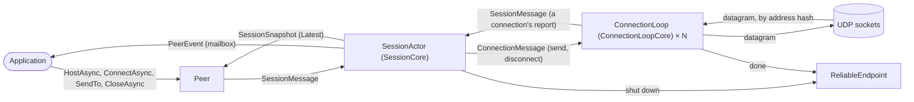
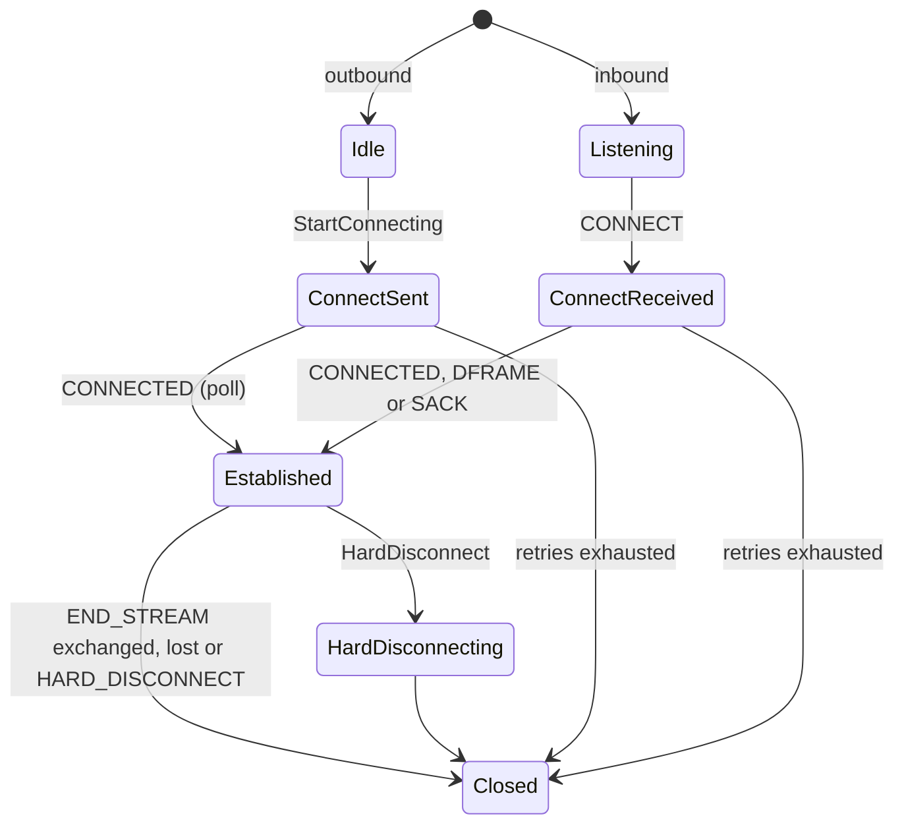

# Aigamo.Otsuki

A DirectPlay 8 peer (`IDirectPlay8Peer`), server and client (`IDirectPlay8Server`, `IDirectPlay8Client`) for .NET, built on the messages of [Aigamo.Otsuki.Messages](../Aigamo.Otsuki.Messages). It speaks the wire protocol of DirectX 8/9 DirectPlay over UDP:

* [[MC-DPL8R]: DirectPlay 8 Protocol: Reliable](https://docs.microsoft.com/en-us/openspecs/windows_protocols/mc-dpl8r/7a35d96c-daca-4311-bc2b-bd6a2f50bf14) – connections, sequencing, acknowledgments and retries on top of UDP.
* [[MC-DPL8CS]: DirectPlay 8 Protocol: Core and Service Providers](https://docs.microsoft.com/en-us/openspecs/windows_protocols/mc-dpl8cs/2968b3eb-a248-4281-b718-8a7d55fd9b36) – sessions, players and the name table.

Peer-to-peer sessions form a full peer mesh: one peer hosts, hands out player IDs (DPNIDs) and owns the name table, and every peer that joins is connected to directly by all the others. In client/server sessions, every client connects to the server only.

It also speaks [[MC-DPLHP]: DirectPlay 8 Protocol: Host and Port Enumeration](https://learn.microsoft.com/en-us/openspecs/windows_protocols/mc-dplhp/ad5042e7-f46f-4ead-ba45-54b833b1a279), with which clients find hosts.

## Usage

```csharp
await using var peer = new Peer();
await peer.SetPeerInfoAsync("Alice");

var application = new ApplicationDescription { GuidApplication = guidApp, MaxPlayers = 2 };
await peer.HostAsync(application);                                    // or:
await peer.ConnectAsync(application, "192.168.0.10", Peer.DefaultPort);

peer.SendTo(Peer.AllPlayers, data, SendFlags.Guaranteed | SendFlags.NoLoopback);
```

Notifications arrive as `PeerEvent`s, a union of `PlayerCreated`, `PlayerDestroyed`, `DataReceived`, `ConnectCompleted`, `SendCompleted`, `SessionTerminated`, `HostMigrated`, `PeerInfoUpdated`, `GroupCreated`, `GroupDestroyed`, `PlayerAddedToGroup` and `PlayerRemovedFromGroup`. Consume them in one of two ways, not both:

```csharp
// Polling, once per frame of a game loop, like IDirectPlay8ThreadPool::DoWork:
peer.DoWork(e => e.Match(
	PlayerCreated: created => /* created.Player.Name */,
	PlayerDestroyed: destroyed => /* destroyed.Player, destroyed.Reason */,
	DataReceived: received => /* received.Sender, received.Data */,
	ConnectCompleted: completed => /* completed.Result */,
	SendCompleted: completed => /* completed.Handle, completed.Result */,
	SessionTerminated: terminated => /* terminated.Result */,
	HostMigrated: migrated => /* migrated.NewHost */,
	PeerInfoUpdated: updated => /* updated.Player */,
	GroupCreated: created => /* created.Group */,
	GroupDestroyed: destroyed => /* destroyed.Group, destroyed.Reason */,
	PlayerAddedToGroup: added => /* added.Group, added.Player */,
	PlayerRemovedFromGroup: removed => /* removed.Group, removed.Player */
));

// Or streaming:
await foreach (var e in peer.ReadEventsAsync()) { /* ... */ }
```

[Aigamo.Otsuki.ConsoleApp](../Aigamo.Otsuki.ConsoleApp) is a complete example: a chat in which one peer hosts, the others join, and the oldest peer takes over when the host leaves.

### Finding hosts

```csharp
await foreach (var host in peer.EnumHostsAsync(new IPEndPoint(IPAddress.Broadcast, Peer.DefaultPort), guidApp))
	Console.WriteLine($"{host.Application.SessionName} at {host.HostEndPoint}, {host.CurrentPlayers} players, {host.RoundTripTime}");
```

`EnumHostsAsync` sends EnumQuery datagrams on a socket of its own, so a peer can enumerate before it hosts or connects. A host answers unless its session has `SessionFlags.NoEnumerations`, with the data set by `SetEnumResponseData`.

### Groups and player information

```csharp
var team = await peer.CreateGroupAsync("Red team", flags: GroupFlags.AutoDestruct);
await peer.AddPlayerToGroupAsync(team, peer.LocalPlayer);
peer.SendTo(team, data);                                              // to every member
await peer.SetPeerInfoAsync("Alice (away)");                          // PeerInfoUpdated on every peer
```

Only the host changes the name table, so other peers ask it, and each call completes when the host's answer comes back, or fails with `DirectPlayException` after `PeerOptions.RequestTimeout`. The host can also remove a player with `DestroyPeerAsync`.

### Host migration

With `SessionFlags.MigrateHost`, losing the host does not end the session. The remaining peers agree on the player that joined first as the new host; it collects the name table operations it missed and resynchronizes everyone, and every peer raises `PlayerDestroyed` for the old host and then `HostMigrated`. Groups that the old host created with `GroupFlags.AutoDestruct` go with it, and requests a peer had sent to the old host fail with `ResultCode.ConnectionLost`.

### Client/server

`Server` and `Client` are the counterparts of IDirectPlay8Server and IDirectPlay8Client, on the same protocol with `SessionFlags.ClientServer`:

```csharp
await using var server = new Server();
await server.HostAsync(application);
server.SendTo(Peer.AllPlayers, data);                                 // to every client

await using var client = new Client();
await client.ConnectAsync(application, "192.168.0.10");
client.Send(data);                                                    // to the server
```

The server knows every client; a client knows only the server and itself. Groups belong to the server, and a client's information update reaches only the server, while the server's reaches every client. Client/server sessions never migrate.

### Packet signing

Host with `SessionFlags.FastSigned` or `SessionFlags.FullSigned` to sign every frame of the session ([MC-DPL8R] section 3.1.5.2.7). Connecting peers sign as the host chose.

## Design

### Why actors

A DirectPlay peer reacts to three independent sources at once: datagrams arriving on the socket, timers firing (retries, delayed acknowledgments, keep-alives, time-outs), and the application calling `SendTo`, `HostAsync` and so on. All three change the same protocol state. The classic answer is locks around that state, which is how the previous implementation did it, with about seven lock objects and `Monitor.Wait`/`PulseAll`. That is hard to get right and harder to change.

Otsuki uses the actor model instead. Every piece of protocol state belongs to exactly one actor, and nothing else ever touches it. The other threads interact with an actor only by posting a message to its mailbox, and the actor handles its messages one at a time. Each handler therefore reads like plain sequential code, with no locks, no races between a timer and a receive, and no state changing underneath it.

### The core and its shell

Actors keep two threads out of one piece of state, but not two messages out of an order nobody expected, and nothing stops code inside an actor from starting a task or calling another actor's object directly ([docs/OtsukiThreading.md](../../docs/OtsukiThreading.md#why-actors-still-race)). So the protocol itself is not written as actors. It lives in [Aigamo.Otsuki.Core](../Aigamo.Otsuki.Core), as state machines that do nothing by themselves:

* **Inputs** are a message and the time: `SessionCore.Handle(message, now)` and `ConnectionLoopCore.Handle(item, now)`. The core reads no clock; its timers are deadlines in a queue of its own ([`LoopTimer`](../Aigamo.Otsuki.Core/Reliable/LoopTimer.cs)), and the caller wakes it at the nearest.
* **Outputs** are calls on an interface that the caller implements, made in the order the core decides on, before `Handle` returns: send a datagram, post to a connection, publish the snapshot, raise an event, answer a command ([`ISessionOutputs`](../Aigamo.Otsuki.Core/Session/ISessionOutputs.cs), [`IConnectionLoopOutputs`](../Aigamo.Otsuki.Core/Reliable/ConnectionLoopCore.cs)). The core cannot complete a task: it names a command's `Completion` in an answer, which it gives only once the input is done and its snapshot published.
* **The compiler keeps it so.** In the core, and in [Aigamo.Otsuki.Messages](../Aigamo.Otsuki.Messages) whose wire formats it runs, an analyzer reports as errors the threads, tasks, timers, sockets and actors of .NET and of Otsuki, a read of a clock, an `async` function, and a static field that can change. A race inside the core needs code that does not build.

This assembly is the *shell*: the actors that run the cores, one message at a time, and carry out their outputs; the timers that wake them; the transports; and the facades. It is the [sans-I/O](https://sans-io.readthedocs.io) style of protocol libraries such as quinn-proto and h11.

### The actor

[`Actor<TMessage>`](../Aigamo.Otsuki.Actors/Actor.cs) is deliberately small, on a mailbox of its own, [`Mailbox<T>`](../Aigamo.Otsuki.Actors/Mailbox.cs):

* A queue that any thread posts to (`ConcurrentQueue<T>` and a count kept with `Interlocked`), and only the actor receives from.
* A run on a [`MailboxScheduler`](../Aigamo.Otsuki.Actors/MailboxScheduler.cs), the thread pool unless `PeerOptions.Scheduler` says otherwise, which calls `Receive(message)` for each message, one after the other, while the mailbox has messages.
* `Post(message)`, which only enqueues and is safe to call from any thread. It returns `false` once the actor has stopped.

A few rules keep this sound:

* **Handlers never block and never await.** They update state, post messages to other actors, send datagrams (a UDP send does not block) and return.
* **Messages are immutable records.** Whatever crosses an actor boundary can be read safely by the receiver.
* **Timers only post.** Each actor that runs a core arms one runtime timer for the core's nearest deadline ([`LoopAlarm`](Actors/LoopAlarm.cs)), which posts to the actor; the core then fires the timers that are due. A firing carries a generation number, so one that a later start or a cancel replaced is dropped (`TryConsume`). No timer callback ever touches state.
* **Other threads read snapshots.** When the application needs to read state, as with `GetPeerInfo` or `Players`, the session publishes an immutable `SessionSnapshot`, updated by the players and groups that changed, which the facade reads ([`Latest<T>`](../Aigamo.Otsuki.Actors/Latest.cs)). No reader ever sees the actor's mutable state. A command's task completes only after the snapshot that shows what it did is published.

### The actors and how messages flow



* [`Peer`](Peer.cs) is the facade the application uses. Its methods turn calls into `SessionMessage`s and post them. Calls that need an answer (`HostAsync`, `ConnectAsync`, `CloseAsync`, the group and info calls) carry a `Completion`, which holds the `TaskCompletionSource` that the session's actor completes when its core answers. [`Server`](Server.cs) and [`Client`](Client.cs) are narrower facades over a `Peer` for client/server sessions, and [`HostEnumerator`](Enumeration/HostEnumerator.cs) runs `EnumHostsAsync` on a transport of its own. `Peer.Queues` tells how many messages wait in each of its mailboxes.
* [`SessionActor`](Session/SessionActor.cs) runs a [`SessionCore`](../Aigamo.Otsuki.Core/Session/SessionCore.cs), the core protocol ([MC-DPL8CS]): the name table and its groups, joining and leaving, integrity checks, info updates, host migration, and routing application data to and from players and groups. It raises `PeerEvent`s into a mailbox that the application drains.
* [`ConnectionLoop`](Reliable/ConnectionLoop.cs) runs a [`ConnectionLoopCore`](../Aigamo.Otsuki.Core/Reliable/ConnectionLoopCore.cs), for the connections whose remote address hashes to it: it keeps their table, decodes each datagram and hands it to the connection for its source address, creating one for a new CONNECT, and runs their timers. A peer has as many loops as `PeerOptions.ConnectionLoops` says, one by default; a server of many clients gives one to each core it can spare.
* [`ReliableConnection`](../Aigamo.Otsuki.Core/Reliable/ReliableConnection.cs) is one connection of the reliable protocol ([MC-DPL8R]) to one remote address, a state machine that its loop runs one message at a time. Its reports go to the session as messages, in order for any one connection. The session knows it only by its handle, a [`Connection`](../Aigamo.Otsuki.Core/Reliable/Connection.cs) that nothing changes, so the two never share the connection's state.
* [`ReliableEndpoint`](Reliable/ReliableEndpoint.cs) owns the datagram transport, a UDP socket unless [`PeerOptions.TransportFactory`](PeerOptions.cs) says otherwise, and the loops. Its transport's receive loop gives each datagram to the loop of its source address. Shut down, it keeps the transport until every loop has reported that its last connection has ended, so that a connection saying goodbye (HARD_DISCONNECT) is not cut off. A [`UdpDatagramTransport`](Transport/UdpDatagramTransport.cs) may bind several sockets to its port, one for each loop to send on.

For example, a chat message from another peer travels: socket receive loop → `ConnectionLoop` (decode, look up the connection) → `ReliableConnection` (sequence, acknowledge, reassemble) → `SessionActor` (map the connection to a player) → `PeerEvent.DataReceived` → the application.

### State machines

`ReliableConnection` and `SessionCore` are state machines:

* The state is a union, a `[GenerateMatch]` abstract record whose cases are the states: [`ConnectionState`](../Aigamo.Otsuki.Core/Reliable/ConnectionState.cs) and [`SessionState`](../Aigamo.Otsuki.Core/Session/SessionState.cs). Data that only matters in one phase lives on that case. For example, `ConnectionState.Established` holds the [`ReliableChannel`](../Aigamo.Otsuki.Core/Reliable/ReliableChannel.cs) that does the sequencing, and `SessionState.Joining` holds the join progress.
* Each case lists the transitions it allows by implementing transition interfaces such as `ICanAcceptConnect`, `ICanRetransmit`, `ICanAdmitPlayers` and `ICanCompleteJoining`. They live one per file in the `Transitions` folders.
* A transition handles one or more message types in a default interface implementation of `Execute(machine, message)`, which returns the next state.
* For each message, the machine checks whether its current state implements the transition for that message type. If it does, the machine runs it and stores the returned state. If it does not, the message is ignored, which is what the protocol specifications require of unexpected packets.

The connection's states follow [MC-DPL8R] section 3.1, figure 1:



The session's states are `Idle`, `Hosting`, `Connecting` (waiting for DN_SEND_CONNECT_INFO), `Joining` (in the name table, waiting for the established peers to connect), `Connected`, `Terminated`, `Closing` and `Closed`.

Every dispatch over a union (mailbox messages, wire messages, peer events) uses the `Match` that [Aigamo.MatchGenerator](https://github.com/ycanardeau/MatchGenerator) generates, so adding a case is a compile error until every `Match` handles it. The messages of every frame and of the data path take a `switch` ahead of it, as `Match` makes a delegate for each case at each call. Fallible steps such as validating a join or parsing a DirectPlay URL return [Aigamo.Results](https://github.com/ycanardeau/Results) values instead of throwing.

### Threading summary

| Code | Runs on |
| --- | --- |
| `Peer` methods | the caller's thread; they only post |
| `SessionActor`, each `ConnectionLoop`, `ReliableEndpoint` | one message at a time, on the thread pool (or `PeerOptions.Scheduler`) |
| `SessionCore`, each `ConnectionLoopCore` | the thread of the actor that runs it, inside its `Receive`; never by themselves |
| Timer callbacks, the socket receive loops | the thread pool; they only post |
| `DoWork` handlers | the thread that calls `DoWork` |
| `ReadEventsAsync` consumers | wherever the consumer awaits |

Otsuki's code takes no lock: an analyzer reports one as an error, and a volatile field, and the concurrent types of .NET, everywhere but in [Aigamo.Otsuki.Actors](../Aigamo.Otsuki.Actors), where the mailbox and its siblings are. In the core it also reports threads, tasks, timers, sockets, clocks, `async` and static state ([The core and its shell](#the-core-and-its-shell)). The types of the runtime that it uses, such as the thread pool, the sockets and the timers, take locks of their own.

## Testing

Everything that touches the network goes through `IDatagramTransport`, and all timing through `TimeProvider`, which only the shell reads: the core is told the time. So the core can be tested alone, with no thread at all: [`ConnectionLoopCoreTests`](../Aigamo.Otsuki.Tests/ConnectionLoopCoreTests.cs) give two loops' cores datagrams and times of their choosing, and check the order of what they did, such as every HARD_DISCONNECT of a goodbye coming before the loop is done. Endpoints need not be IP addresses: [`StreamDatagramTransport`](Transport/StreamDatagramTransport.cs) carries datagrams over the reliable streams of an `IStreamConnector`, such as Bluetooth RFCOMM channels, addressed by the connector's own kind of endpoint. The tests run peers over an in-memory network that can lose, delay, reorder and partition datagrams, and use short protocol timings. They cover meshes of up to six peers, 20% packet loss with reordering, messages larger than a frame, coalescing, fast and full signing across sequence wraps, tampered frames, host enumeration, groups, info updates, host migration (with the new host collecting operations it missed), client/server sessions, peers leaving or dropping off, and rejected joins. Protocol tests replay the sample packets from [MC-DPL8R] section 4 byte for byte, and one test runs two peers over real loopback UDP. The simulation tests run whole sessions on one thread, every actor's messages and every datagram in an order a seed chooses, on a clock that moves only when nothing else can ([`ManualScheduler`](../Aigamo.Otsuki.Actors/MailboxScheduler.cs)), over a network that loses what the seed says, and try a hundred orders each: client/server sessions with datagrams lost and doubled, a rejected join, peers joining a peer-to-peer session at once, host migration after the host closes or stops, and peers leaving in the middle of a join or a migration, after which the others must agree, reach each other and let a newcomer in. Every peer's events and snapshot are checked after every step. The cores draw their randomness from the shell, which a test seeds, so a seed takes the same order again, to the byte: a failing seed is a test that repeats.

[Aigamo.Otsuki.LoadTest](../Aigamo.Otsuki.LoadTest) runs a server and processes of clients over UDP, and reports each second the messages and datagrams on both sides, the latency, the CPU, the garbage, the lock contentions and every mailbox's depth. What it measured is in [docs/OtsukiThreading.md](../../docs/OtsukiThreading.md#measurements).

## Limitations

* No DPNSVR: hosts answer host enumeration on their own port only, not through the well-known port 6073.
* Host migration assumes that the peers agree on who is left. A peer follows a new host only once it has lost the old one too, so a peer cut off from the host alone cannot take the session from it; but a network split into parts that each lose the host ends with one host per part, and nothing merges them again.
* While a new host collects the name table, it holds back name table changes, joins and integrity checks until migration completes.
* Not yet tested against real DirectPlay. Some details are interpretations where the specifications are silent or ambiguous:
  * The bit order of the send mask, which tells a receiver that lost unreliable frames will not be resent, is interpreted as bit 0 being the frame just before.
  * [MC-DPL8R] says only that the secret modifier of full signing is "derived from" a payload. Otsuki takes the first 64 bits of the payload's SHA-1 digest.
  * [MC-DPL8CS] lists only `dpnidRequesting` and `dwPacketContext` in DN_CREATE_GROUP, which do not tell peers what the group is. Otsuki appends the group's DN_NAMETABLE_ENTRY_INFO.
  * A DPNGROUP_AUTODESTRUCT group is destroyed when its creator leaves, as the DirectPlay SDK documents, rather than when its last member leaves, as the flag's description in [MC-DPL8CS] reads.
