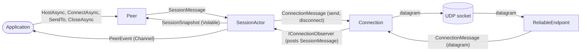
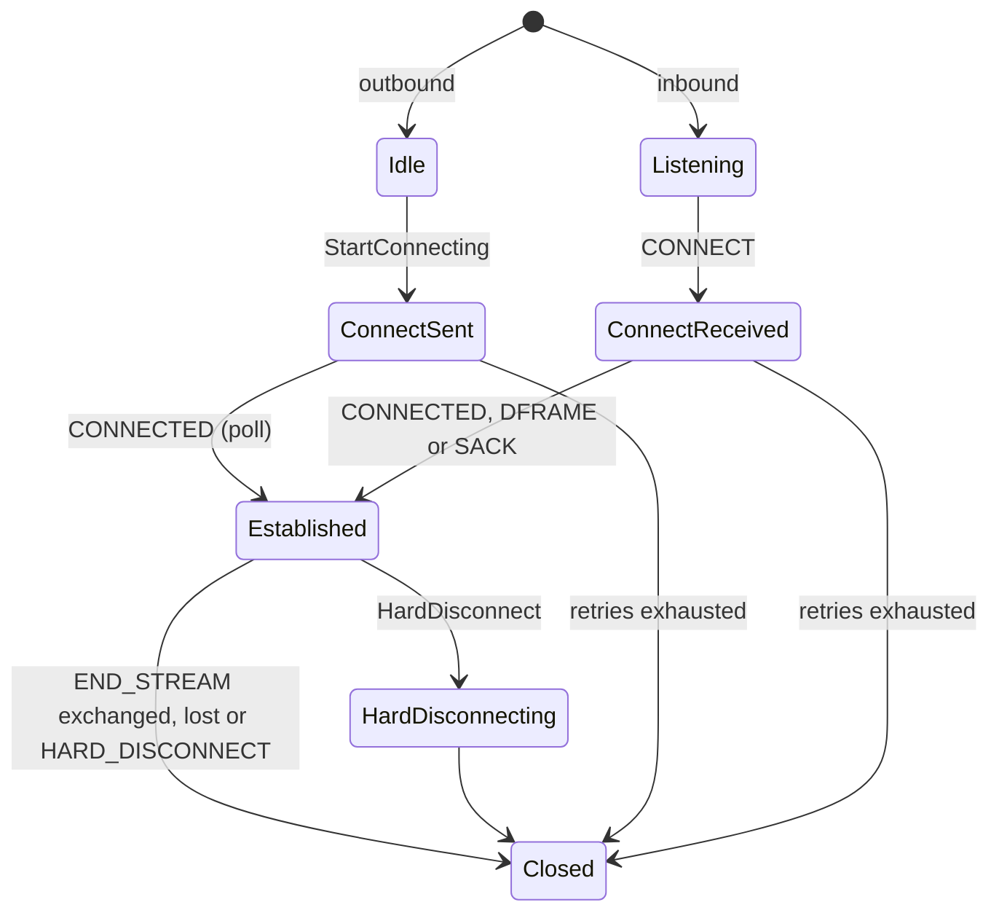

# Aigamo.Otsuki

A DirectPlay 8 peer (`IDirectPlay8Peer`), server and client (`IDirectPlay8Server`, `IDirectPlay8Client`) for .NET, built on the messages of [Aigamo.Otsuki.Messages](../Aigamo.Otsuki.Messages). It speaks the wire protocol of DirectX 8/9 DirectPlay over UDP:

* [[MC-DPL8R]: DirectPlay 8 Protocol: Reliable](https://docs.microsoft.com/en-us/openspecs/windows_protocols/mc-dpl8r/7a35d96c-daca-4311-bc2b-bd6a2f50bf14) – connections, sequencing, acknowledgments and retries on top of UDP.
* [[MC-DPL8CS]: DirectPlay 8 Protocol: Core and Service Providers](https://docs.microsoft.com/en-us/openspecs/windows_protocols/mc-dpl8cs/2968b3eb-a248-4281-b718-8a7d55fd9b36) – sessions, players and the name table.

Peer-to-peer sessions form a full peer mesh: one peer hosts, hands out player IDs (DPNIDs) and owns the name table, and every peer that joins is connected to directly by all the others. In client/server sessions, every client connects to the server only.

It also speaks [[MC-DPLHP]: DirectPlay 8 Protocol: Host and Port Enumeration](https://learn.microsoft.com/en-us/openspecs/windows_protocols/mc-dplhp/ad5042e7-f46f-4ead-ba45-54b833b1a279), with which clients find hosts.

## Usage

```csharp
await using var peer = new Peer();
await peer.SetPeerInfo("Alice");

var application = new ApplicationDescription { GuidApplication = guidApp, MaxPlayers = 2 };
await peer.HostAsync(application);                                    // or:
await peer.ConnectAsync(application, "192.168.0.10", Peer.DefaultPort);

peer.SendTo(Peer.AllPlayers, data, SendFlags.Guaranteed | SendFlags.NoLoopback);
```

Notifications arrive as `PeerEvent`s, a union of `PlayerCreated`, `PlayerDestroyed`, `DataReceived`, `ConnectCompleted`, `SendCompleted`, `SessionTerminated`, `HostMigrated`, `PeerInfoUpdated`, `GroupCreated`, `GroupDestroyed`, `PlayerAddedToGroup` and `PlayerRemovedFromGroup`. Consume them in one of two ways, not both:

```csharp
// Polling, once per frame of a game loop, like IDirectPlay8ThreadPool::DoWork:
peer.DoWork(e => e.Match(
	PlayerCreated: created => /* created.Player.Name */,
	PlayerDestroyed: destroyed => /* destroyed.Player, destroyed.Reason */,
	DataReceived: received => /* received.Sender, received.Data */,
	ConnectCompleted: completed => /* completed.Result */,
	SendCompleted: completed => /* completed.Handle, completed.Result */,
	SessionTerminated: terminated => /* terminated.Result */,
	HostMigrated: migrated => /* migrated.NewHost */,
	PeerInfoUpdated: updated => /* updated.Player */,
	GroupCreated: created => /* created.Group */,
	GroupDestroyed: destroyed => /* destroyed.Group, destroyed.Reason */,
	PlayerAddedToGroup: added => /* added.Group, added.Player */,
	PlayerRemovedFromGroup: removed => /* removed.Group, removed.Player */
));

// Or streaming:
await foreach (var e in peer.ReadEventsAsync()) { /* ... */ }
```

[Aigamo.Otsuki.ConsoleApp](../Aigamo.Otsuki.ConsoleApp) is a complete example: a chat in which one peer hosts, the others join, and the oldest peer takes over when the host leaves.

### Finding hosts

```csharp
await foreach (var host in peer.EnumHostsAsync(new IPEndPoint(IPAddress.Broadcast, Peer.DefaultPort), guidApp))
	Console.WriteLine($"{host.Application.SessionName} at {host.HostEndPoint}, {host.CurrentPlayers} players, {host.RoundTripTime}");
```

`EnumHostsAsync` sends EnumQuery datagrams on a socket of its own, so a peer can enumerate before it hosts or connects. A host answers unless its session has `SessionFlags.NoEnumerations`, with the data set by `SetEnumResponseData`.

### Groups and player information

```csharp
var team = await peer.CreateGroupAsync("Red team", flags: GroupFlags.AutoDestruct);
await peer.AddPlayerToGroupAsync(team, peer.LocalPlayer);
peer.SendTo(team, data);                                              // to every member
await peer.SetPeerInfo("Alice (away)");                               // PeerInfoUpdated on every peer
```

Only the host changes the name table, so other peers ask it, and each call completes when the host's answer comes back, or fails with `DirectPlayException` after `PeerOptions.RequestTimeout`. The host can also remove a player with `DestroyPeerAsync`.

### Host migration

With `SessionFlags.MigrateHost`, losing the host does not end the session. The remaining peers agree on the player that joined first as the new host; it collects the name table operations it missed and resynchronizes everyone, and every peer raises `PlayerDestroyed` for the old host and then `HostMigrated`. Groups that the old host created with `GroupFlags.AutoDestruct` go with it, and requests a peer had sent to the old host fail with `ResultCode.ConnectionLost`.

### Client/server

`Server` and `Client` are the counterparts of IDirectPlay8Server and IDirectPlay8Client, on the same protocol with `SessionFlags.ClientServer`:

```csharp
await using var server = new Server();
await server.HostAsync(application);
server.SendTo(Peer.AllPlayers, data);                                 // to every client

await using var client = new Client();
await client.ConnectAsync(application, "192.168.0.10");
client.Send(data);                                                    // to the server
```

The server knows every client; a client knows only the server and itself. Groups belong to the server, and a client's information update reaches only the server, while the server's reaches every client. Client/server sessions never migrate.

### Packet signing

Host with `SessionFlags.FastSigned` or `SessionFlags.FullSigned` to sign every frame of the session ([MC-DPL8R] section 3.1.5.2.7). Connecting peers sign as the host chose.

## Design

### Why actors

A DirectPlay peer reacts to three independent sources at once: datagrams arriving on the socket, timers firing (retries, delayed acknowledgments, keep-alives, time-outs), and the application calling `SendTo`, `HostAsync` and so on. All three change the same protocol state. The classic answer is locks around that state, which is how the previous implementation did it, with about seven lock objects and `Monitor.Wait`/`PulseAll`. That is hard to get right and harder to change.

Otsuki uses the actor model instead. Every piece of protocol state belongs to exactly one actor, and nothing else ever touches it. The other threads interact with an actor only by posting a message to its mailbox, and the actor handles its messages one at a time. Each handler therefore reads like plain sequential code, with no locks, no races between a timer and a receive, and no state changing underneath it.

### The actor

[`Actor<TMessage>`](Actors/Actor.cs) is deliberately small:

* A mailbox: an unbounded `System.Threading.Channels.Channel<TMessage>` with a single reader.
* A message loop that reads the mailbox and calls `Receive(message)` for each message, one after the other.
* `Post(message)`, which only enqueues and is safe to call from any thread. It returns `false` once the actor has stopped.

A few rules keep this sound:

* **Handlers never block and never await.** They update state, post messages to other actors, send datagrams (a UDP send does not block) and return.
* **Messages are immutable records.** Whatever crosses an actor boundary can be read safely by the receiver.
* **Timers only post.** [`ActorTimer`](Actors/ActorTimer.cs) wraps a `TimeProvider` timer whose callback posts a message carrying a generation number. Rescheduling or canceling bumps the generation, so a firing that was already on its way is recognized as stale and dropped (`TryConsume`). No timer callback ever touches state.
* **Other threads read snapshots.** When the application needs to read state, as with `GetPeerInfo` or `Players`, the session publishes an immutable `SessionSnapshot` that the facade reads with `Volatile.Read`. No reader ever sees the actor's mutable state.

### The actors and how messages flow



* [`Peer`](Peer.cs) is the facade the application uses. Its methods turn calls into `SessionMessage`s and post them. Calls that need an answer (`HostAsync`, `ConnectAsync`, `CloseAsync`, the group and info calls) carry a `TaskCompletionSource` that the session completes. [`Server`](Server.cs) and [`Client`](Client.cs) are narrower facades over a `Peer` for client/server sessions, and [`HostEnumerator`](Enumeration/HostEnumerator.cs) runs `EnumHostsAsync` on a transport of its own.
* [`SessionActor`](Session/SessionActor.cs) runs the core protocol ([MC-DPL8CS]): the name table and its groups, joining and leaving, integrity checks, info updates, host migration, and routing application data to and from players and groups. It raises `PeerEvent`s into a channel that the application drains.
* [`ReliableEndpoint`](Reliable/ReliableEndpoint.cs) owns the datagram transport, a UDP socket unless [`PeerOptions.TransportFactory`](PeerOptions.cs) says otherwise, and the connection table. It decodes each datagram and forwards it to the `Connection` for its source address, creating one for a new CONNECT.
* [`Connection`](Reliable/Connection.cs) is one connection of the reliable protocol ([MC-DPL8R]) to one remote address, so there is one actor per partner. It reports to the session through `IConnectionObserver`, which the session implements by posting to its own mailbox. For any one connection, the session receives its notifications in order.

For example, a chat message from another peer travels: socket receive loop → `ReliableEndpoint` (decode, look up the connection) → `Connection` (sequence, acknowledge, reassemble) → `SessionActor` (map the connection to a player) → `PeerEvent.DataReceived` → the application.

### State machines

`Connection` and `SessionActor` are state machines:

* The state is a union, a `[GenerateMatch]` abstract record whose cases are the states: [`ConnectionState`](Reliable/ConnectionState.cs) and [`SessionState`](Session/SessionState.cs). Data that only matters in one phase lives on that case. For example, `ConnectionState.Established` holds the [`ReliableChannel`](Reliable/ReliableChannel.cs) that does the sequencing, and `SessionState.Joining` holds the join progress.
* Each case lists the transitions it allows by implementing transition interfaces such as `ICanAcceptConnect`, `ICanRetransmit`, `ICanAdmitPlayers` and `ICanCompleteJoining`. They live one per file in the `Transitions` folders.
* A transition handles one or more message types in a default interface implementation of `Execute(actor, message)`, which returns the next state.
* For each message, the actor checks whether its current state implements the transition for that message type. If it does, the actor runs it and stores the returned state. If it does not, the message is ignored, which is what the protocol specifications require of unexpected packets.

The connection's states follow [MC-DPL8R] section 3.1, figure 1:



The session's states are `Idle`, `Hosting`, `Connecting` (waiting for DN_SEND_CONNECT_INFO), `Joining` (in the name table, waiting for the established peers to connect), `Connected`, `Terminated`, `Closing` and `Closed`.

Every dispatch over a union (mailbox messages, wire messages, peer events) uses the `Match` that [Aigamo.MatchGenerator](https://github.com/ycanardeau/MatchGenerator) generates, so adding a case is a compile error until every `Match` handles it. Fallible steps such as validating a join or parsing a DirectPlay URL return [Aigamo.Results](https://github.com/ycanardeau/Results) values instead of throwing.

### Threading summary

| Code | Runs on |
| --- | --- |
| `Peer` methods | the caller's thread; they only post |
| `SessionActor`, each `Connection`, `ReliableEndpoint` | one message at a time, on the thread pool |
| Timer callbacks, the socket receive loop | the thread pool; they only post |
| `DoWork` handlers | the thread that calls `DoWork` |
| `ReadEventsAsync` consumers | wherever the consumer awaits |

There are no locks anywhere in the library. The only cross-thread primitives are the channels, one `Interlocked.Increment` for send handles, and the `Volatile` snapshot.

## Testing

Everything that touches the network goes through `IDatagramTransport`, and all timing through `TimeProvider`. Endpoints need not be IP addresses: [`StreamDatagramTransport`](Transport/StreamDatagramTransport.cs) carries datagrams over the reliable streams of an `IStreamConnector`, such as Bluetooth RFCOMM channels, addressed by the connector's own kind of endpoint. The tests run peers over an in-memory network that can lose, delay, reorder and partition datagrams, and use short protocol timings. They cover meshes of up to six peers, 20% packet loss with reordering, messages larger than a frame, coalescing, fast and full signing across sequence wraps, tampered frames, host enumeration, groups, info updates, host migration (with the new host collecting operations it missed), client/server sessions, peers leaving or dropping off, and rejected joins. Protocol tests replay the sample packets from [MC-DPL8R] section 4 byte for byte, and one test runs two peers over real loopback UDP.

## Limitations

* No DPNSVR: hosts answer host enumeration on their own port only, not through the well-known port 6073.
* Host migration assumes that the peers agree on who is left. A peer follows a new host only once it has lost the old one too, so a peer cut off from the host alone cannot take the session from it; but a network split into parts that each lose the host ends with one host per part, and nothing merges them again.
* While a new host collects the name table, it holds back name table changes, joins and integrity checks until migration completes.
* Not yet tested against real DirectPlay. Some details are interpretations where the specifications are silent or ambiguous:
  * The bit order of the send mask, which tells a receiver that lost unreliable frames will not be resent, is interpreted as bit 0 being the frame just before.
  * [MC-DPL8R] says only that the secret modifier of full signing is "derived from" a payload. Otsuki takes the first 64 bits of the payload's SHA-1 digest.
  * [MC-DPL8CS] lists only `dpnidRequesting` and `dwPacketContext` in DN_CREATE_GROUP, which do not tell peers what the group is. Otsuki appends the group's DN_NAMETABLE_ENTRY_INFO.
  * A DPNGROUP_AUTODESTRUCT group is destroyed when its creator leaves, as the DirectPlay SDK documents, rather than when its last member leaves, as the flag's description in [MC-DPL8CS] reads.
