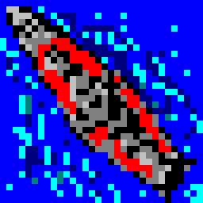

<p align="center">
  
</p>

<h1 align="center">OpenNSPW</h1>

<p align="center">
  <b>Naval South Pacific War, reborn.</b><br>
  Ken-ichi Tokumitsu's real-time naval strategy game of the Pacific War, ported line by line to C#,<br>
  and playable again on Windows, macOS, Linux and Android.
</p>

<p align="center">
  <a href="https://github.com/ycanardeau/OpenNSPW/releases"></a>
  <a href="https://github.com/ycanardeau/OpenNSPW/releases"></a>
  <a href="https://github.com/ycanardeau/OpenNSPW/actions/workflows/dotnet.yml"></a>
  <a href="https://dotnet.microsoft.com/"></a>
  <a href="https://monogame.net/"></a>
</p>

<p align="center">
  <a href="https://github.com/ycanardeau/OpenNSPW/releases/download/v0.0.1-alpha.19/OpenNSPW-0.0.1-alpha.19-win-x64.zip"></a>
  <a href="https://github.com/ycanardeau/OpenNSPW/releases/download/v0.0.1-alpha.19/OpenNSPW-0.0.1-alpha.19-osx-arm64.zip"></a>
  <a href="https://github.com/ycanardeau/OpenNSPW/releases/download/v0.0.1-alpha.19/OpenNSPW-0.0.1-alpha.19-linux-x64.AppImage"></a>
  <a href="https://github.com/ycanardeau/OpenNSPW/releases/download/v0.0.1-alpha.19/OpenNSPW-0.0.1-alpha.19-android.apk"></a>
</p>

## The game
Naval South Pacific War (NSPW) is a real-time strategy game for Windows by Ken-ichi Tokumitsu (徳光 健一) / Nara-Shika Seisakusho (奈良鹿製作所), first released in 1999. You command a carrier task force of the U.S. Navy or the Imperial Japanese Navy: arm your carriers' planes with bombs or torpedoes and launch them from the flight deck, escort them with fighters, screen your carriers with battleships and destroyers, land troops from your transports, and find the enemy's fleet before it finds yours. Its multiplayer edition, Naval South Pacific War on the Net, followed in 2002.

OpenNSPW brings both back, on today's systems:

- **Single player.** All 37 scenarios of NSPW 1.22, in four sets, from Pearl Harbor and the Coral Sea to Midway, Santa Cruz and the Marianas, against the original's computer player.
- **Multiplayer.** Host or join a game of NSPW on the Net, over DirectPlay 8 reimplemented in modern .NET ([Otsuki](Otsuki)): no Windows, no COM, no DirectX.
- **Replays.** Every battle is recorded. Watch it again from your own view or with both fleets revealed, at up to 8× speed, skip to any moment, or take over and play on from there.
- **Map editor.** The original's own, for building your own scenarios.
- **English and 日本語**, switchable from the main menu.
- **Touch play** on Android phones and tablets, in landscape.
- **Options** that neither original has, such as a steady speed that plays the same battle whatever the speed.
- **Nothing to install.** Each download runs on its own, without .NET, and carries the original's maps, scenarios and sounds.

## Download
Get the latest build from the buttons above, or every build from [Releases](https://github.com/ycanardeau/OpenNSPW/releases).

| Platform | Download | To play |
| --- | --- | --- |
| Windows (x64) | [`win-x64.zip`](https://github.com/ycanardeau/OpenNSPW/releases/download/v0.0.1-alpha.19/OpenNSPW-0.0.1-alpha.19-win-x64.zip) | Extract it, and start `OpenNspw.Desktop.exe`. |
| macOS (Apple silicon) | [`osx-arm64.zip`](https://github.com/ycanardeau/OpenNSPW/releases/download/v0.0.1-alpha.19/OpenNSPW-0.0.1-alpha.19-osx-arm64.zip) | Extract `OpenNSPW.app`, and start it. It isn't notarized, so the first time, click **Open Anyway** in System Settings → Privacy & Security, or run `xattr -dr com.apple.quarantine OpenNSPW.app`. |
| Linux (x64) | [`linux-x64.AppImage`](https://github.com/ycanardeau/OpenNSPW/releases/download/v0.0.1-alpha.19/OpenNSPW-0.0.1-alpha.19-linux-x64.AppImage) | `chmod +x` it, and start it. |
| Android 6 or later | [`android.apk`](https://github.com/ycanardeau/OpenNSPW/releases/download/v0.0.1-alpha.19/OpenNSPW-0.0.1-alpha.19-android.apk) | Open it on the device, allowing installs from where you opened it. |

Each release lists the SHA-256 of its downloads in `SHA256SUMS`, and GitHub keeps a signed record that this repository's workflow built them: `gh attestation verify <file> --repo ycanardeau/OpenNSPW`.

## Faithful to the last bit
OpenNSPW is not a remake. It is the original game, ported so closely that it computes the very same battles.

- **An exact port of the NSPW NET source** ([Original/NSPW_NET](Original/NSPW_NET)): one C# file per C++ file, the same functions in the same order, the same structs with the same memory layout, the same `rand()` sequence and math, even the original's bugs. See [docs/Porting.md](docs/Porting.md).
- **Tested against the original.** The unmodified C++ source, built as it was, records traces of the whole game state, frame by frame; the port replays them and must reach the same state, byte for byte. Traces recorded from NSPW 1.22 itself check the single player the same way ([docs/Verification.md](docs/Verification.md)).
- **Single player from the machine code.** NSPW 1.22's computer player, scenarios and victory conditions exist only in its executable. They are rewritten in C#, and each rewrite is checked against the original function, run in an x86 emulator ([Enzan](Enzan)) as translated by the [Disassembler](Disassembler). See [docs/Singleplayer.md](docs/Singleplayer.md).
- **A new UI on top, the old game underneath.** The menus, the battle screen and the dialogs are new, built with [Saruhashi](Saruhashi), but they give the game exactly the orders that the original's clicks give. See [docs/UI.md](docs/UI.md).

## What's in this repository
| Folder | What it is |
| --- | --- |
| [OpenNSPW](OpenNSPW) | The game: the port, its single player, replays, UI, and the desktop and Android apps. |
| [Otsuki](Otsuki) | DirectPlay 8 for modern .NET: host, find and join sessions over UDP, on any OS. |
| [Saruhashi](Saruhashi) | A WinForms-style UI toolkit for MonoGame. |
| [Enzan](Enzan) | An x86 emulator for machine code translated to C#. |
| [Disassembler](Disassembler) | Translates the functions of NSPW 1.22's executable to C# for Enzan. |
| [Aigamo.Extensions.Primitives](Aigamo.Extensions.Primitives) | Allocation-free helpers for the low and high halves of integers. |
| [Original](Original) | The original games and the NSPW NET source, kept unmodified as the reference. |

Otsuki, Saruhashi and Enzan are also on NuGet: [Aigamo.Otsuki](https://www.nuget.org/packages/Aigamo.Otsuki), [Aigamo.Saruhashi.MonoGame](https://www.nuget.org/packages/Aigamo.Saruhashi.MonoGame), [Aigamo.Enzan](https://www.nuget.org/packages/Aigamo.Enzan).

## Building from source
You need the [.NET 10 SDK](https://dotnet.microsoft.com/download/dotnet/10.0).

```bash
git clone https://github.com/ycanardeau/OpenNSPW.git
cd OpenNSPW
dotnet run --project OpenNSPW/OpenNspw.Desktop
```

The desktop app also takes `--singleplayer <scenario>` to start a scenario at once, `--replay <file>` to watch a replay, and `--data <folder>` to play your own copy of NSPW NET's files. The [docs](docs) explain the design, from [threading](docs/OtsukiThreading.md) to [sprite sheets](docs/SpriteSheets.md).

## Credits
[Naval South Pacific War](https://www.vector.co.jp/soft/winnt/game/se136841.html) and [Naval South Pacific War on the Net](https://www.vector.co.jp/soft/win95/game/se242938.html) are the work of **[Ken-ichi Tokumitsu (徳光 健一)](https://x.com/tokumizman) / [Nara-Shika Seisakusho (奈良鹿製作所)](http://narashikabranch.web.fc2.com/)**, who keeps all their copyrights. The games are freeware, and their files are redistributed here under his terms: see [Original/README.md](Original/README.md). Thank you for the game.

OpenNSPW runs on [MonoGame](https://monogame.net/), [MonoGame.Extended](https://github.com/MonoGame-Extended/Monogame-Extended) and [FontStashSharp](https://github.com/FontStashSharp/FontStashSharp), and writes with the [BIZ UDGothic](https://github.com/googlefonts/morisawa-biz-ud-gothic) fonts by Morisawa ([SIL Open Font License](OpenNSPW/OpenNspw.App/Fonts/OFL.txt)).
