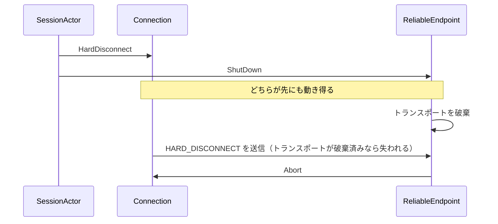
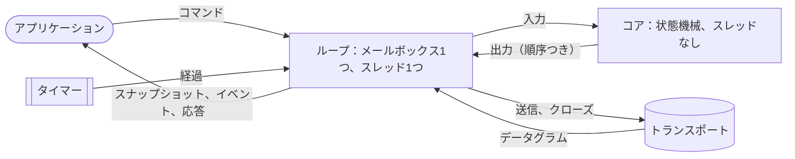
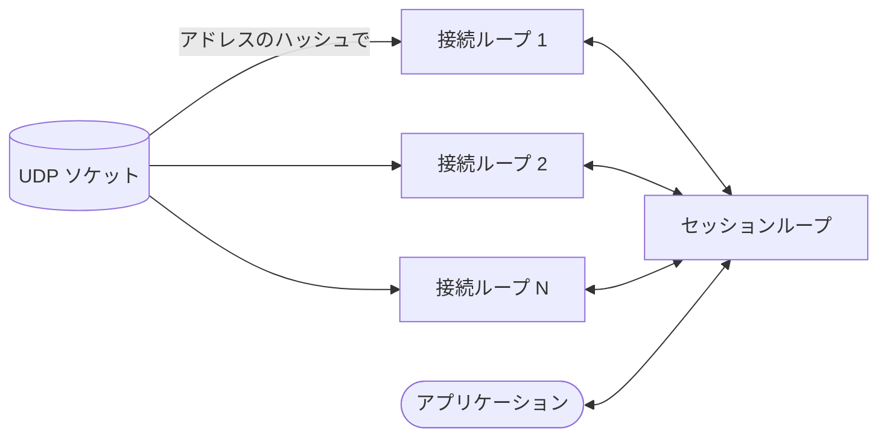

# Otsuki のスレッド設計
[Otsuki](../Otsuki/Aigamo.Otsuki) で、構造的にレースが起こり得ないようにするための提案です。アクターによってプロトコルの状態を守るロックはなくなりましたが、状態は複数のメールボックスに分かれています。あるメールボックスから別のメールボックスへメッセージが渡るたびに、2つの出来事がどちらの順にも起こり得る場所が生まれます。この文書では、アクターを使ってもなぜレースが起きるのか、Otsuki のどこで今それが起きているのか、なぜそうしたレースは見つけにくいのかを説明します。そのうえで、スレッドを一切持たず1つのループが駆動するプロトコルのコアと、順序が来るのを待つのではなくあらゆる順序を自分で選ぶテストを提案します。さらに、そのループを分割して、Otsuki のコードにロックのないまま1台のサーバーが1万以上のクライアントを抱えられるようにし、それを計測で確かめる方法を述べます。

これは提案であり、最終的な設計ではありません。まだ決めるべきことは[未決事項](#未決事項)にまとめています。一部はすでに済んでおり、何が済んだかと負荷テストで計測した結果は[進捗](#進捗)にあります。

## 進捗
ここまでに済んだことです。各手順は1コミットで、Otsuki のテストが通り、負荷テスト（[`Aigamo.Otsuki.LoadTest`](../Otsuki/Aigamo.Otsuki.LoadTest)）で計測しています。

| 手順 | 状態 |
| --- | --- |
| 0. 負荷テスト | 済み。UDP 上のサーバーとクライアントのプロセス群で、毎秒、メッセージ数、両側のデータグラム数、遅延、CPU、ガベージ、ロック競合、スレッドプール、各メールボックスの深さ（`Peer.Queues`）を報告する。 |
| 1. 署名モードを `Connect` に渡す | この計画の手順より前に済み（[署名モード](#署名モード)）。 |
| 2. 応答をスナップショットの後に | 済み。遷移は `SessionActor.Reply` と `Fail` で応答し、これらはメッセージが終わってスナップショットを公開した後でタスクを完了させる。回帰テストが20回繰り返して確かめる。 |
| 3. スナップショットを作り直さず更新する | 済み。変更の印がついたプレイヤーとグループだけを作り直し、何も変わらなければ何も公開しない。デバッグビルドでは、公開のたびにスナップショットが一から作ったものと等しいことを確かめる。 |
| 4、12. 接続を個別のアクターから出す | 計画とは違う形で済み。ピアの接続は*接続ループ*で動く。数は `PeerOptions.ConnectionLoops`（既定は1）で、相手のアドレスのハッシュがループを選ぶ。セッションは独立したアクターのまま残り、エンドポイントはトランスポートを持ってシャットダウンを2段階で取りまとめるだけになった。計画にあったセッションと接続をまとめた単一ループは済んでいない（[残っていること](#残っていること)）。 |
| 5. トランスポートをループが所有する | 一部。各ループは自分の UDP ソケットで送る。ソケットはすべて同じポートにバインドされている（`UdpDatagramTransport(endPoint, sockets)`）ので、ループどうしがカーネルの中で待ち合わない。 |
| 10. タイマーをループの中に | 済み。ループは接続の期限を1つの優先度付きキューに持ち、最も近い期限にランタイムのタイマーを1つだけ仕掛ける。期限を後ろへずらすだけの再始動にはコストがかからない。 |
| 11. ロックのないメールボックス | 今のところ不要。Otsuki のコードは送信にも受信にもロックを取らない（`ConcurrentQueue` と `Interlocked`。キュー自身のロックはセグメントが満杯になったときだけ取られる）。負荷時のサーバープロセス全体でランタイムが数えたロック競合は毎秒1〜8回で、時間の使われ先ではない。 |
| 13. 受信を複数のコアに | 一部。ポートのソケットはすべて受信する。macOS はポートのデータグラムを1つのソケットに渡すので、macOS では1つの受信ループがすべてを受け取る。 |
| 14. データグラムごとの確保をなくす | 一部。すべてのフレームとデータ経路のディスパッチは、生成された `Match`（呼び出しのたびにデリゲートを作っていた）の前に `switch` を置き、確認応答はクロージャの代わりにループを使う。データグラムあたりのガベージは約 15 KB から約 1 KB に減った。バッファのプールは済んでいない。 |
| 15. セッションを迂回するデータ経路 | 未着手。このマシンで運べるどの負荷でも、セッションはボトルネックにならなかった。 |
| 8. シミュレーション | 一部。手順6と7のコアなしで済んだ。`ManualScheduler`（`PeerOptions.Scheduler`）が、ピアのアクターをテストのスレッドで1メッセージずつ、シードが選ぶ順に動かす。時計は手動で進め、ネットワークは各データグラムの配送を独立した1ステップとして扱う（[`SimulationTests`](../Otsuki/Aigamo.Otsuki.Tests/SimulationTests.cs)）。参加・送信・クローズするクライアント／サーバーのセッションを100通りの順序で、拒否される参加を100通りの順序で試す。後者はトランスポートを破棄した後で何も送ってはならず、昔のさよならのレースを戻すと最初のシードで失敗する。同じシードはほぼ同じ順序を再現するが、完全ではない。セッションの GUID と、接続の集合をハッシュでたどる順序が実行ごとに変わるため。 |
| 6、7. 作用を出力に、コアのアセンブリ | 未着手。 |
| 9. ロックのない `StreamDatagramTransport` | この計画の手順より前に済み。リンクはアクターが持つ。 |
| 17. README | 済み。設計の節で、ループ、メールボックスとそのスケジューラー、スナップショット、シミュレーション、負荷テストを説明している。 |
| ほかに | ブロードキャストはクライアントごとではなくループごとに1通になった。完了を報告しない送信（`SendFlags.NoComplete`）はセッションが追跡しなくなり、接続も何も報告し返さない。 |

### 計測
Apple M2（性能コア4、高効率コア4、16 GB）1台、macOS、ループバックで計測しました。クライアントは同じマシン上の1〜5個の専用プロセスで動き、各クライアントは Otsuki の `Client` そのものです。特に断りがなければ、各クライアントは32バイトの保証付きメッセージを毎秒30通送り、サーバーは全クライアントに毎秒20回の更新を送ります。ループとソケットができてからは、サーバーはそれぞれ4つ使います。値は、全クライアントが参加してからさらに3秒たった後の各秒の中央値（停止時間と競合は平均値）で、p99 は最も悪かった秒の値です。

| 実行 | クライアント | 受信メッセージ/秒 | 送信メッセージ/秒 | データグラム 受信／送信 /秒 | 受信 p99 (ms) | 更新 p99 (ms) | サーバー CPU（コア） | 確保 (MB/s) | GC 停止 (ms/s) | ロック競合/秒 |
| --- | --- | --- | --- | --- | --- | --- | --- | --- | --- | --- |
| 着手前 | 1,000 | 4,451 | 20,000 | 32,890 / 32,854 | 13,096 | 12,145 | 2.28 | 677 | 48.9 | 15.0 |
| スナップショットの更新（3） | 1,000 | 29,999 | 20,000 | 49,975 / 50,003 | 72 | 79 | 1.61 | 179 | 8.5 | 3.8 |
| ループ（4、12） | 1,000 | 30,067 | 20,000 | 49,944 / 49,928 | 107 | 213 | 1.38 | 217 | 10.4 | 0.9 |
| ループのタイマー（10） | 1,000 | 30,018 | 20,000 | 49,998 / 49,998 | 109 | 131 | 1.14 | 207 | 7.6 | 8.1 |
| メッセージごとのデリゲートなし（14） | 1,000 | 29,953 | 20,000 | 49,953 / 49,953 | 119 | 74 | 1.13 | 93 | 5.1 | 2.7 |
| 毎秒メッセージ1通・更新1回 | 10,000 | 10,006 | 10,000 | 19,810 / 22,868 | 852 | 950 | 0.72 | 40 | 3.2 | 4.0 |

計測で分かったことを、分かった順に並べます。

1. **メッセージのたびにスナップショットを作り直していた。** 着手前のサーバーは数百クライアントまでしか受けられませんでした。それを超えると、セッションは名前表のコピーに時間を使い、メールボックスは際限なく伸び、遅延は秒単位に達しました。変わったところだけでスナップショットを更新するようにしたことで、1,000 クライアントで定常状態に入りました。
2. **メールボックスのホップ、タイマー、送信。** 2,000 以上では、サーバーの時間は、すべての接続のスレッドが共有する1つのソケットへの `sendto`（スレッド時間の48%。接続はすでに4つのループに乗っていた）、`recvfrom`（11%）、そして接続のタイマーを再始動するたびに取られるランタイムのタイマーキューのロック（8%）に使われていました。ループ、ループごとのソケット、ループのタイマーで、1,000 クライアントでのサーバーは 1.6 コアから 1.1 コアになりました。
3. **`Match` のデリゲート。** 生成された `Match` は種類ごとにデリゲートを取り、呼び出しのたびに作り直されます。接続へのメッセージ1通につき約17個、セッションへのメッセージ1通につき約30個です。すべてのフレームで使う種類について前に `switch` を置いたことで、ガベージは半分になりました。
4. **限界はサーバーではなくマシン。** 毎秒30メッセージでは約2,000、毎秒3メッセージでは約9,000を超えたところで、クライアントは確認応答を期限内に受け取れなくなって諦めました。そのときサーバーのメールボックスは空のままで、使っていたのは2コア未満でした。理由はシステム自身のカウンターに出ています。ある実行では、ループバックインターフェースは315万パケットを通しましたが、IP が受け取ったのは141万でした。残りはその間で落とされています。そのとき全コアが、サーバー、5つのクライアントプロセス、そしてシステムで埋まっていました。ループバック上で、クライアントが同じ8コア（半分は高効率コア）を使う条件では、先に音を上げるのはシステムです。
5. **10,000 クライアント。** 各クライアントが毎秒メッセージ1通・更新1回のとき、10,000 クライアントが毎秒500の速さで参加し、1分の残りのあいだ1つも欠けずに残りました。サーバーは 0.7 コアを使い、毎秒 40 MB を確保し、メールボックスは空のままでした。プロセス全体でランタイムが数えたロック競合は毎秒4回です。Otsuki のコードはロックを取りません（アナライザーが確かめています）。ランタイムの型（スレッドプール、ソケット、タイマー）は自分のロックを取り、トレースではそれらを区別できませんでした（[ホットパスにロックを置かない](#ホットパスにロックを置かない)）。約 0.9 秒の p99 遅延は、CPU を奪われたクライアントのプロセスとシステムの取りこぼしによるもので、サーバーのキューによるものではありません。

つまりこのアーキテクチャは、このマシンのループバックが運べるメッセージレートで、1台のサーバーに 10,000 接続を運びます。10,000 でより高いレートを試すには、クライアントを別のマシンに置く必要があります。負荷テストはそれに対応しています（`clients --server HOST:PORT`）。

### 残っていること
- **手順6と7**、コンパイラがスレッドなしに保つコア。[提案](#提案)の確実さはまだありません。今はセッションと接続ループは別々のメールボックスで、その順序は[ループ間のレース](#ループ間のレース)のルールで守られ、2つのシナリオでシミュレーションが確かめています。ホストの移行、P2P のメッシュ、データグラムの喪失はまだシミュレーションしていません。また、同じシードで完全に同じ順序を再現するには、GUID と接続の集合を決定的にする必要があります。
- **手順15**、セッションを迂回するデータ経路と、**バッファのプール**（14）。セッションかガベージコレクターが限界だと示す負荷が出てからにします。それにはクライアントを別のマシンに置く必要があります。
- **システムコールをまとめる**（16）。その計測が求めたときだけ。

## 出発点の設計
[進捗](#進捗)の手順より前の姿です。[README](../Otsuki/Aigamo.Otsuki/README.md#design) に書かれています。要約すると次のとおりです。

- [`SessionActor`](../Otsuki/Aigamo.Otsuki/Session/SessionActor.cs) はコアプロトコルを動かし、`SessionSnapshot` を公開します。[`Peer`](../Otsuki/Aigamo.Otsuki/Peer.cs) はアプリケーションのスレッドからそれを読みます。
- [`ReliableEndpoint`](../Otsuki/Aigamo.Otsuki/Reliable/ReliableEndpoint.cs) はトランスポートと接続表を持ち、データグラムを振り分けます。
- 各 [`Connection`](../Otsuki/Aigamo.Otsuki/Reliable/Connection.cs) は相手1人につき1つの独立したアクターで、トランスポートを直接呼んでフレームを送ります。

3種類のアクターが、それぞれ1つのメールボックスを持ち、それぞれスレッドプール上で動いています。

## なぜアクターでもレースが起きるか
アクターが保証するのは1つだけです。自分の状態は、一度に1つのメッセージにしか触られません。だから同じアクターへの2つのメッセージが入り混じることはなく、その状態にロックは要りません。これで*データ競合*、つまり2つのスレッドが同じメモリに同時に触ることは防げますが、それは1つのアクターが本当に持っている状態に限られます。

それ以外のことは何も保証しません。

- **メールボックスの間に順序はありません。** 順序があるのは、1つの送り手と1つの受け手の間だけです。A が B に M1、M2 の順に送れば、B は M1 を先に見ます。アクターの上に作られた Erlang も、同じことしか約束していません（[Processes](https://www.erlang.org/doc/system/ref_man_processes.html)）。A が B と C に送ると、B と C はどちらが先にも動き得て、その後に彼らがすることも同様です。
- **アクターをまたぐ不可分性はありません。** 2つのアクターの状態を変える操作は2通のメッセージになり、その間に他のメッセージが動き得ます。
- **アクターの外にあるものは誰も所有しません。** 2つのアクターが共に呼ぶオブジェクトや、別のアクターのスレッドからメソッドが読むフィールドは、再び共有メモリになり、アクターモデルにはそれが見えません。

つまりレースは、別の種類のものとして残ります。1つのメモリに2つのスレッドがいるのではなく、2つのメッセージが作者の想定しなかった順序で来るのです。Otsuki にはそれぞれの種類があります。

| レース | 種類 |
| --- | --- |
| [スナップショットと応答](#スナップショットと応答) | 1つのアクターから出る2つの経路の間に順序がなく、それを別のスレッドが読む |
| [さよならとソケット](#さよならとソケット) | メールボックスの間に順序がない。1つのアクターが他の2つに送る |
| [署名モード](#署名モード) | 別のアクターのスレッドから読まれるフィールド |
| [共有されたトランスポート](#共有されたトランスポート) | 複数のアクターが呼ぶオブジェクト |

アクターを少なく大きくすれば、そうした場所は減りますが、メールボックスが2つあれば少なくとも1か所はできます。それがない設計は、プロトコルの状態のために2つ目のメールボックスを持たず、プロトコルの中にスレッドを一切持たない設計だけです（[提案](#提案)）。

## Otsuki でレースが起きる場所
### スナップショットと応答
*手順2で解決。セッションはスナップショットを公開してからコマンドに応答する。*

`await peer.ConnectAsync(...)` の直後の `peer.LocalEndPoint` は、エンドポイントを見られなければなりません。セッションはコマンドの `TaskCompletionSource` を完了させ、スナップショットを公開します。呼び出し元の続きはタスクが完了した瞬間にスレッドプールで動くので、公開が先でなければなりません。かつてはそうなっていませんでした。今は [`ICanConnect`](../Otsuki/Aigamo.Otsuki/Session/Transitions/ICanConnect.cs) が `TrySetResult()` の前に `Publish()` を呼んでいます。

それでもこの順序は、各遷移が自分で守っている約束事にすぎません。[`ICanHost`](../Otsuki/Aigamo.Otsuki/Session/Transitions/ICanHost.cs) は `Publish()` を呼ばずに `HostAsync` を完了させており、正しく動くのは途中で `MarkCreated` が公開しているからにすぎません。`SessionActor.Receive` の最後の `Publish()` はすべての遷移の後に動くので、完了を覆うには常に遅すぎます。何かが公開する前にタスクを完了させる遷移が新しく加われば、このバグは戻ってきます。そして、その時間の幅は数マイクロ秒なので、テストで捕まる見込みは薄いです。

### さよならとソケット
*解決済み。エンドポイントは最後の接続が終わるまでトランスポートを保ち、ハード切断中の接続は再送を終えてから終わる。ループになってからは、シャットダウンはさよならの後で各ループに送られ、すべてのループが最後の接続の終了を報告してからトランスポートが破棄される。*

参加に失敗すると、[`FailConnect`](../Otsuki/Aigamo.Otsuki/Session/SessionActor.cs) は各接続に `HardDisconnect` を送り、続けてエンドポイントに `ShutDown` を送ります。



接続とエンドポイントは別のスレッドで動くので、接続が HARD_DISCONNECT を送る前に、エンドポイントがトランスポートを破棄し得ます。その場合、送信は黙って失敗します。[`UdpDatagramTransport`](../Otsuki/Aigamo.Otsuki/Transport/UdpDatagramTransport.cs) は `ObjectDisposedException` を握りつぶし、[`StreamDatagramTransport`](../Otsuki/Aigamo.Otsuki/Transport/StreamDatagramTransport.cs) は破棄済みなら何もせず戻ります。相手がこちらの離脱を知るのは、自分のタイムアウトが切れたときだけです。

接続が先に動いた場合でも、エンドポイントの `Abort` が接続のメールボックスで `HardDisconnect` のすぐ後ろに続くので、接続は再送タイマー（[`ICanHardDisconnect`](../Otsuki/Aigamo.Otsuki/Reliable/Transitions/ICanHardDisconnect.cs)）が再送する前に `HardDisconnecting` を抜けます。HARD_DISCONNECT は多くて1回しか送られず、エンドポイントが先なら1回も送られません。

### 署名モード
*解決済み。セッションは自分の署名モードを `Connect` に渡し、ループは受信側の接続のために自分の署名モードを持つ。*

[`ReliableEndpoint.Connect`](../Otsuki/Aigamo.Otsuki/Reliable/ReliableEndpoint.cs) はセッションのスレッドで呼ばれ、そのコメントは不変の状態しか読まないと述べています。実際には `_signing` を読んでおり、これは `SetSigning` がエンドポイントのスレッドで書きます。セッションが `SetSigning` を送るのは、ホストするときか DN_SEND_CONNECT_INFO を受け取ったときで、他のピアに接続するのはその後のメッセージが届いてからです。なので実際には、読むずっと前に書き込みは終わっています。ただし、それを保証するものは何もありません。外向きの接続が古い値 `PacketSigning.None` を読むと、リスナーが提示するどんな署名でも受け入れてしまいます。これはまさに `OfferedSigning` が防ぐためにある格下げです。

### 共有されたトランスポート
*ストリームでは解決済み。`StreamDatagramTransport` のリンクはロックなしにアクターが持つ。UDP トランスポートは今も複数のスレッド（ループのスレッド）から送信されるが、これはシステムが許している。ループごとにソケットを持てば、2つのループが1つのソケットを共有することはない。*

[`IDatagramTransport`](../Otsuki/Aigamo.Otsuki/Transport/IDatagramTransport.cs) は、`Send` を複数のスレッドから同時に呼んでも安全であることを要求しています。各接続が自分のループから、エンドポイントも自分のループから呼ぶからです。UDP ソケットはそれを許します。`StreamDatagramTransport` はリンクの表を持っており、`Send` が接続のスレッドから表に追加し、同時にリンクのタスクが表から削除し、コネクターが受け付けたストリームを追加します。そのためこの表を `lock` で守っています。README のスレッドの要約には、ライブラリのどこにもロックはないと書かれていますが、もはや事実ではありません。

このロックは症状です。トランスポートが、1つのアクターに所有されるのではなく、複数のアクターに共有される状態になっているのです。

### テストは実時間を待つ
*一部解決。シミュレーションのテストは手動の時計で動き、順序を選ぶ（[進捗](#進捗)）。ほかのテストは今も本物のスレッドと実時間で動く。*

どのテストも、本物のアクターをスレッドプールで動かし、プロトコルのタイミングをミリ秒単位に縮め、`Task.Delay` で最大10秒のタイムアウトまでイベントをポーリングしています（[`EventLog`](../Otsuki/Aigamo.Otsuki.Tests/EventLog.cs)）。テストが見るのはスレッドプールがたまたま作った入り混じり方だけなので、上のどの順序も強制できず、ある順序に依存する失敗は、まれに落ちる不安定なテストとして現れます。`TimeProvider` はあらゆる所に注入されていますが、一度も偽物に差し替えられていません。

## なぜ見つけにくいか
これらのレースは、コードを読んだりテストを走らせたりして見つかったのではなく、問いを持って1本の経路を追うことで見つかりました。それを隠しているものは、人であれコーディングエージェントであれ、どのレビュアーにも当てはまります。

- **どの行も間違っていません。** ハンドラーはそれぞれ単独では正しいです。さよならのレースは、`FailConnect`、`ReliableEndpoint.HandleShutDown`、`ICanHardDisconnect`、トランスポートの `Dispose` の間の順序にあります。4つのファイルのどれも、他のタイミングには触れていません。
- **バグは「欠けているもの」です。** コードのどこにも「この2つはどちらの順でも動き得る」とは書かれていません。それに気づくには、メールボックスの順序は送り手と受け手の組ごとにしかないと知っていて、送信のあらゆる組についてそれを問う必要があります。
- **名前とコメントが安全だと言っています。** 「アクター」「不変の状態しか読まない」「どこにもロックはない」。コードを読むにはたいていそれらを信じる必要があり、信じた読み手はそこで探すのをやめます。
- **テストが通ります。** スレッドプールはほとんど常に同じ順序を選び、時間の幅はマイクロ秒です。たまに出る失敗は遅いマシンのせいに見え、手軽な直し方はタイムアウトを延ばすことです。
- **順序の数は掛け算で増えます。** 読むときは1つの順序をたどりますが、飛んでいるメッセージが n 通なら順序は最大 n! 通りあります。そのすべてを確かめるには、より注意深く読むことではなく、すべてを実行する道具が要ります。

コーディングエージェントは、たいていのバグよりここで弱くなります。まさに通用しない2つのこと、つまり局所的にコードを読むこととテストを走らせることに頼っているからです。LLM が書いた Java を調べたある研究では、あるモデルで並行処理のバグが他のモデルよりはるかに多く見つかりました（[arXiv 2508.14727](https://arxiv.org/abs/2508.14727)）。CONCUR ベンチマークは、テストではこの種のバグを捕まえられないため、生成された並行コードをモデル検査で判定しています（[arXiv 2603.03683](https://arxiv.org/abs/2603.03683)）。エージェントが書いてレビューした同じコードが、1行ずつは正しいのにレースを起こすことはあり得ます。

したがって答えは、人やエージェントによるより注意深いレビューではなく、こうしたレースを書けないコードと、書けてしまうコードを拒否するコンパイラです。

## 目標
- **プロトコルに並行性を持たせません。** プロトコルのコードは決して2つのスレッドで動かず、動かすこともできません。それを可能にする型をコンパイラが拒否するからです。そうすればプロトコル内のデータ競合やメールボックス間のレースは、単に存在しないのではなく、起こり得なくなります。
- **作用は決めた順に行います。** プロトコルがすると決めたこと（送信、クローズ、公開、完了）は、その順に1つのスレッドで実行されます。
- **応答はスナップショットの後、それを構造で保証します。** プロトコルのコードはタスクを完了できません。完了させるのはループ内の1か所だけで、それは公開の後です。
- **テストが順序を選びます。** テストはピアとネットワークを仮想時計とともに1つのスレッドで決定的に動かし、同じ入力の多くの順序を試せます。
- **大人数でもロックなし。** 1台のサーバーが1万以上のアクティブなクライアントを抱え、Otsuki のコードのホットパスにロックがないことを、主張ではなく負荷テストで示します（[大人数への対応](#大人数への対応)）。
- **プロトコルは変えません。** 遷移、ワイヤー形式、既存のテストが確かめている振る舞いはそのままです。

## 提案
### スレッドのないコア
プロトコルは*コア*になります。セッションと接続の状態機械で、I/O もタイマーもタスクもスレッドも持ちません。外から駆動されます。

```
core.Handle(input, now) → outputs
```

- **入力**：あるアドレスからのデータグラム、切れたタイマー、アプリケーションからのコマンド（`TaskCompletionSource` の代わりにリクエスト ID を持つ）。
- **出力**（順序つき）：データグラムの送信、タイマーの開始や取り消し、トランスポートのクローズ、スナップショットの公開、イベントの発行、リクエストへの応答。
- **時刻**は入力（`now`）なので、コアは時計を読みません。

1回の呼び出しの中で、コアは入力と、それが引き起こすすべてを最後まで実行します。セッションに報告する接続は、その報告を内部のキューに入れ、コアは戻る前にそれを空にします。今のセッションのメールボックスと同じ働きです。つまりコアは、ある状態から次の状態への1つの逐次的な関数です。2つの入力が入り混じることはありません。誰もそれを同時に2回呼べないからです（呼ぶのは[ループ](#1つのループ)だけです）。

これは [quinn-proto](https://docs.rs/quinn-proto)（QUIC）や [h11](https://h11.readthedocs.io)（HTTP/1.1）といったプロトコルライブラリの *sans-I/O* という方式です。プロトコルはバイト列と時刻を与えられる状態機械で、ソケットとスレッドはアプリケーションが持ちます。

### 1つのループ


*シェル*は1つのアクター、つまりループです。そのメールボックスがすべての入力を受け取ります。トランスポートの受信ループからのデータグラム、タイマーの発火、アプリケーションのコマンドです。それぞれについてコアを呼び、出力を順に自分のスレッドで実行します。それから最終的なスナップショットを公開し、応答を完了させます。この順で、1か所で行います。

各レースは次のように消えます。

- **スナップショットと応答。** コアはタスクを完了できず、応答を出力するだけです。ループは公開の後にしか応答を完了させません。
- **さよなら。** コアは*HARD_DISCONNECT の送信*を*クローズ*より先に出力し、ループはそれを1つのスレッドでその順に実行します。ストリームトランスポートのクローズは、リンクにすでに積まれたデータグラムを取り消さずに送り切ります。
- **署名モード。** コアの状態の一部になります。
- **共有されたトランスポート。** `Send` を呼ぶのはループだけなので、`IDatagramTransport` は「`Send` は複数のスレッドから安全に呼べること」という要求を外せます。

非決定的なまま残るのは、入力が届く順序です。どのデータグラムが先に来るか、応答より先にタイマーが発火するか。これはネットワーク本来の非決定性で、コードのレースではありません。コアは仕様が求めるとおりあらゆる順序を扱わなければならず、[シミュレーションテスト](#決定的シミュレーションテスト)が多くの順序を試します。

代償：接続は並列には動かなくなります（[パフォーマンス](#パフォーマンス)）。

### パフォーマンス
数人のピアのセッションについて、構造から言えることは次のとおりです（大人数の数値は[計測](#計測)にあります）。

- **直列の部分はもともと直列です。** アプリケーションに届くペイロードはすべて、`SessionActor` を一度に1つずつ通ります。接続を並列に動かして分散できるのは、信頼性レイヤーの仕事（復号、確認応答、再組み立て、署名）だけです。
- **経由する回数が減ります。** 今は受信したデータグラムがエンドポイント、接続、セッションと3つのメールボックスを渡り、そのたびにチャネルへの書き込み、レコードの確保、スレッドプールのスレッドの起床が起きます。1つのループなら渡るのは1つです。ソケットからイベントまでの遅延は、増えるのではなく減るはずです。
- **ループはブロックしてはいけません。** UDP の送信は実際にはブロックせず、ストリームトランスポートはデータグラムをキューに積むだけです。

何百、何千というクライアントに1つのループで足りるかは分かっておらず、今のコードについても同様です。セッションを通る経路は同じく直列だからです。これは[大人数への対応](#大人数への対応)で扱います。

### コンパイラがコアをシングルスレッドに保つ
コアは独自のアセンブリ `Aigamo.Otsuki.Core` に移り、シェルがそれを参照します。その中では次のようにします。

- [BannedApiAnalyzers](https://github.com/dotnet/roslyn-analyzers/blob/main/src/Microsoft.CodeAnalysis.BannedApiAnalyzers/BannedApiAnalyzers.Help.md) が、スレッドをまたいで仕事を始めたり共有したりする型を拒否します。`Task`、`TaskCompletionSource`、`Thread`、`ThreadPool`、`Timer`、`TimeProvider`、`Channel`、`Monitor`、`Interlocked`、`Volatile`、並行コレクション、ソケットの型です。
- [アナライザーのプロジェクト](../Otsuki/Aigamo.Otsuki.Analyzers)のルールが、`lock`、`async` と `await`、可変の `static` フィールドを報告します。

そうすれば、コア内のレースにはコンパイルの通らないコードが必要になります。ここで言う「確実」とはこのことです。テストやレビューが探して見つからなかった性質ではなく、ビルドが毎回確かめる性質です。

シェルは小さく保ちます。ループ、ループに送るタイマー、トランスポートです。`StreamDatagramTransport` はリンクの表のために独自のループを持ち、リンクのタスクとコネクターはロックを取る代わりに送信するようになります。アナライザーはシェルでもアクターの基底クラス以外のロックを報告します。

### 決定的シミュレーションテスト
コアは自分では何もしないので、テストは複数のピアのコア、シミュレートしたネットワーク、仮想時計を1つのスレッドで動かせます。データグラムを届け、期限の来たタイマーを発火させ、出力を確かめます。実時間は経たないので30秒のタイムアウトにも時間はかからず、同じシードを与えたテストは毎回同じことをします。

さらに次のことができます。

- **同じ入力の多くの順序。** テストは同じデータグラムとタイマーの発火をあらゆる順序で、あるいはシードを記録した多くのランダムな順序で届け、そのたびに同じ不変条件を確かめられます。失敗したシードは、再現する失敗テストになります。
- **出力の順序。** さよならは1つのリストに対するアサーションになります。*HARD_DISCONNECT の送信*が*クローズ*より先に来ることです。
- **仕様のサンプル**を、今のプロトコルテストと同じくバイト単位でコアに与えます。

今のテストはシミュレーションに移します。シェルを確かめるために、いくつかは本物のスレッドと本物の UDP で残します。

### 今のコードからの対応
`Reliable/Transitions` と `Session/Transitions` の遷移は変わりません。遷移は `Connection` と `SessionActor` のメソッドを呼んでおり、変わるのはそのメソッドがすることです。

| 今 | コアでは |
| --- | --- |
| `Connection.Transmit` がトランスポートを呼ぶ | *送信*の出力を加える |
| `ActorTimer` が `TimeProvider` のタイマーを作る | *タイマー開始*か*タイマー取り消し*の出力を加える。ループのタイマーが世代番号つきの経過入力を送る |
| `IConnectionObserver` がセッションのメールボックスに送る | 報告をコアの内部キューに入れる |
| `Emit`、`Publish` | *イベント*と*スナップショット*の出力を、今と同じ順で加える |
| `TaskCompletionSource.TrySetResult` | リクエスト ID への*応答*の出力を加える |
| `Connection.Timestamp` が `TimeProvider` を読む | 入力の `now` を読む |
| `ReliableEndpoint` の接続表と振り分け | コアの一部になる |

## 大人数への対応
目指すのは、1万以上のアクティブなクライアントを抱えるサーバーと、メッシュが許す限り大きな P2P セッションを、Otsuki のコードにロックのないまま実現し、主張ではなく負荷テストで確かめることです。クライアント／サーバーを先にします。大きなセッションがそもそも可能なのはそちらだからです。

問いはアーキテクチャについてのもので、DirectPlay についてのものではありません。ロックのないアクターとループで、1台のサーバーが1万接続を運べるか。昔からある C10K 問題です。DirectPlay 8 は当時のプロトコルで、どんなアーキテクチャでも取り除けない固有の制限があります。それらは受け入れたうえで記録し（[プロトコルの制限](#プロトコルの制限)）、負荷テストで2種類の制限を見分けます。

### 今のアーキテクチャの制約
コードから見つけたもので、まだ計測していません。

- **直列の経路が1本です。** すべてのデータグラムが受信ループ、次に `ReliableEndpoint` を一度に1つずつ通り、すべてのペイロードがさらに `SessionActor` を一度に1つずつ通ります。並列に動くのは接続だけです。
- **メッセージのたびにスナップショットを作り直しています。** `SessionActor.Receive` は `Publish()` で終わり、これが全プレイヤーと全グループの新しい不変辞書を作ります。1万人いれば、セッションに届くデータグラム1つごとに1万件をコピーします。
- **再始動のたびにランタイムのタイマーを作ります。** `ActorTimer.Start` はタイマーを破棄して新しく作り、キープアライブのタイマーは受信フレームのたびに再始動します（[`ReliableChannel`](../Otsuki/Aigamo.Otsuki/Reliable/ReliableChannel.cs)）。フレームごとにタイマーが確保され、ランタイムのタイマーキューを通り、そこではロックが取られます。
- **送信のたびにロックがあります。** メールボックスは `Channel` で、その `TryWrite` は読み手が1つのチャネルでもロックを取ります。Otsuki 自身のコードにロックはありませんが、送信のたびにランタイムの中で1つ取られます。
- **背圧がありません。** メールボックスに上限がありません。処理が追いつかなくなったサーバーは、メモリが尽きるまでデータグラムを溜め続けます。

### プロトコルの制限
DirectPlay のものとして受け入れ、アーキテクチャでは直しません。

- **メッシュ。** P2P セッションでは各ピアが他のすべてのピアに接続します。100人なら接続は 4,950 本になり、名前表の変更はそのすべてに送られます。クライアント／サーバーのセッションでは、サーバーはクライアント1人につき接続を1本持ち、クライアントどうしは接続しません。
- **プレイヤー ID。** DPNID はプレイヤーの番号の20ビットを保持します。ホストは新しいプレイヤーに次の番号を与え、番号を再利用しないので、稼働中に約100万回の参加を見たサーバーでは番号が一周します。負荷テストでは、それがいつ起きるか、そのとき ID が生きている ID とぶつかるかを記録します。番号の再利用はプロトコルの使い方の変更で、アーキテクチャの変更ではありません。
- **1バイトのシーケンス ID。** 各接続はフレームを256個の ID で番号づけるので、1接続で飛んでいるフレームの数、つまり1接続のスループットに上限があります。これが制限するのはクライアントごとの量で、クライアントの数ではありません。

### 接続ごとに分割したループ


- **接続ループ。** それぞれが、リモートアドレスのハッシュが自分に当たる接続のコアを動かします。その信頼性プロトコル、つまり復号、確認応答、再組み立て、署名、再送です。N の既定値はコア数です。ハッシュには表が要らないので、データグラムの振り分けは共有状態を読みません。
- **セッションループ**はセッションのコアを動かします。名前表、グループ、参加、プレイヤー間の振り分けです。
- **受信は状態を持ちません。** 受信ループは送信元アドレスをハッシュし、その接続ループに送ります。複数の受信ループが1つのソケットを共有できます。そのとき1人のクライアントの2つのデータグラムが順不同で届くことがありますが、それは UDP がもともとすることで、信頼性プロトコルが扱います。
- **送信。** 各接続ループは自分のフレームを共有のソケットで送ります。OS は UDP ソケットへの同時送信を許し、Otsuki はそこに状態を持ちません。
- **ブロードキャスト。** セッションは接続ループごとに1通、宛先の一覧をつけて送り、クライアントごとには送りません。ペイロードは、全員が送る1つの不変の配列です。

N = 1 なら、これは[1つのループ](#1つのループ)の単一ループと同じです。

**データ経路はセッションを迂回します。** 1万クライアントでは、セッションループが出入りするすべてのペイロードを運ぶことになり、最後に残る直列の部分になります。なのでセッションは参加、離脱、グループ、名前表を受け持ち、データは接続ループとアプリケーションの間を流れます。セッションは接続ループに、その接続がどのプレイヤーのものかを伝えます。その後はそのループがプレイヤーの `PlayerCreated`、`DataReceived`、`PlayerDestroyed` を発行するので、1人のプレイヤーに関するイベントはすべて1つのループから順に来ます。アプリケーションからプレイヤーへの送信は、スナップショットで探したそのループへ直接向かいます。

### 1万クライアントで変わること
[検証](#検証)の定常状態のシナリオでは、1万クライアントが毎秒約30万個、サーバーが約20万個のデータグラムを、結合前の時点で送ります。この流量では、1000人では見えなかったコストが結果を決めます。

- **システムコール。** .NET のソケットは、データグラム1つにつきシステムコールを1回します。受信は複数のコアに分散させる必要があります。Linux では受信ループごとに `SO_REUSEPORT` 付きのソケットを1つ持ち、カーネルがクライアントをアドレスで振り分けます。それ以外の環境では、1つのソケットに複数の受信を同時に待たせます。まとめて呼ぶ方式（`recvmmsg`、`sendmmsg`、UDP のセグメンテーションオフロード）は .NET が包んでいないプラットフォームの呼び出しが必要で、計測が求めたときだけ行います。
- **データグラムごとの確保をなくします。** 毎秒50万個の配列はガベージコレクターを忙しくさせます。受信バッファはプールから取り、ループ間のメッセージは構造体かプールしたものにし、フレームはプールしたバッファに書きます。そうするとアプリケーションの API で、受け取ったペイロードを誰がプールに返すのかを決める必要があります（[未決事項](#未決事項)）。
- **アプリケーションへのイベント。** データ経路がセッションを迂回すると、複数のループがイベントを発行します。ループごとにロックのないイベントキューを持たせてアプリケーションが吸い出すか、メールボックスと同じロックフリーの設計で全員が共有する1つのキューにします。
- **ブロードキャストはアプリケーションのコストです。** 1万クライアント全員に毎回の更新を送れば、どのライブラリでも送信は1万回です。ゲームはグループやエリアなどの関心範囲でそれを絞ります。ライブラリはグループへの送信を、各接続ループの中で自分のメンバーの分だけ展開します。
- **参加。** クライアント／サーバーの参加にかかるコストは、10人でも1万人でも同じです。参加するクライアントが受け取るのはサーバーのエントリーと自分のエントリーだけで、クライアントどうしはお互いを知りません（[`ICanAdmitPlayers`](../Otsuki/Aigamo.Otsuki/Session/Transitions/ICanAdmitPlayers.cs)）。なので一斉参加は1万回の小さなハンドシェイクで、接続ループに分散されます。
- **接続1本あたりのメモリ。** 各接続のタイマーはホイールのエントリーになり、送信ウィンドウと再組み立てバッファはプールから取ります。負荷テストで接続1本あたりのバイト数を報告します。
- **OS の制限。** ファイル記述子（macOS は既定で1プロセスあたり256個までなので、負荷をかける側で引き上げます）、ソケットバッファの大きさ、負荷をかける側がバインドできるポートの数です。最大規模の試験は Linux で行い、サーバーは macOS と Windows でも小さめの規模で計測します。
- **負荷をかける側**もサーバーと同じくらい効率的である必要があるので、同じループとプールで動かし、複数のプロセスやマシンに分けます。

### ループ間のレース
各ループのコアはシングルスレッドで、それはコンパイラが確かめます。ループの間には再びメールボックスがあるので、その順序にはルールが要ります。ルールは多くありません。

- **星型。** 接続ループはセッションループとだけ話し、互いには話しません。1本の接続に関することはすべて1つの接続ループにあり、セッションに関することはすべてセッションループにあります。2つのループの間では、メッセージの順序は保たれます。
- **三角形を作りません。** さよならのレースは、1つのアクターが他の2つに送り、その2つの仕事がその後で出会ったことから生まれました。どの手順も、応答を通す以外の方法で2つのループを同時に待ちません。
- **クローズは2段階です。** セッションは各接続ループにクローズを頼み、各ループはさよならを送ってから答えます。ソケットが閉じるのは、すべてが答えた後だけです。
- **1人のプレイヤーに関するイベントはすべて1つのループから。** データ経路がセッションを迂回するためです。
- **ループ間の順序はシミュレーションが選びます。** すべてのループのコアを1つのスレッドで動かし、ループ間のメッセージを、小さなセッションではあらゆる順序で、大きなセッションではシードつきのランダムな順序で届けます。

これは単一ループより弱い保証です。各ループはコンパイラが確かめますが、ループ間のルールはシミュレーションが確かめるのであって、ビルドが証明するのではありません。N = 1 なら完全な保証が成り立ちます。N > 1 は保証の一部を並列性と引き換えにし、その差をシミュレーションが埋めます。

### ホットパスにロックを置かない
- **ロックのないメールボックス。** アクターの基底クラスに独自の多対一（複数の書き手、1つの読み手）キューを持たせます。送信は `Interlocked.Exchange` 1回で（Dmitry Vyukov の侵入型キュー）、`Interlocked.CompareExchange` で立てるフラグにより、ループはアイドルだったときだけスケジュールされます。アナライザーが `Interlocked` を許すのは、アクターの基底クラスだけです。
- **タイマーはループの中に。** コアは期限を出力し、各ループはそれをタイマーホイールに保持して、最も近い期限に対してランタイムのタイマーを1つだけ仕掛けます。タイマーの再始動は、タイマーを確保する代わりにホイールのエントリーを動かすだけです。
- **スナップショットは作り直さず更新します。** プレイヤーとグループは変更ごとに O(log n) で更新する不変コレクションに置き、セッションは何かが変わったときだけ公開します。
- **上限のあるメールボックス。** 追いつかなくなった接続ループは、混雑したネットワークと同じように上限を超えた受信データグラムを捨て、信頼性プロトコルがそれを再送します。アプリケーションからのコマンドは決して捨てません。

「ロックなし」が覆う範囲：Otsuki のコード、そのメールボックス、そのタイマーです。ランタイムと OS は覆いません。アイドルなスレッドを起こすこと、スレッドプールのキュー、ソケット、ガベージコレクターはそれぞれ独自のロックを取り、どの .NET プログラムもそれを避けられません。負荷がかかっているときループは忙しく、忙しいループへの送信はロックを取りません。

### 検証
今のコードでまず走らせ、その後は各手順の後に走らせる負荷テストです。

- **負荷。** 別のプロセス、できれば別のマシンで動く負荷生成器が N 個のクライアントを動かします。各クライアントは自分の UDP ソケットを持ち、Otsuki のクライアントのコアを同じようにループに分散させて動かします。
- **シナリオ。** 一斉参加。定常状態（各クライアントが毎秒30フレームを送り、サーバーが全クライアントに毎秒20回の更新を送る）。クライアントの参加と離脱の繰り返し。並べ替えを伴う1〜5% のロス。規模を増やしていく P2P のメッシュ。
- **計測するもの。** 毎秒の受信と送信のデータグラム数。クライアントの送信からサーバーのイベントまでとその逆の遅延の p50、p99、p99.9。コアごとの CPU。確保とガベージコレクションの停止時間。接続1本あたりのメモリ。メールボックスの最大の深さ。上限で捨てたデータグラム数。そして `Monitor.LockContentionCount` とランタイムの競合イベント。これらはプロセス内で競合したすべてのロックを数えます。
- **検証できたとみなす基準**（仮）：1万クライアントのサーバーが、サーバーが加える遅延の p99 を 10 ms 未満に保って定常状態を維持すること。N をコア数まで増やすとスループットが伸びること。Otsuki のコードに由来するロック競合がないこと。ホットパスでデータグラムごとの確保がないこと。その後、基準のどれかが破れるまで負荷を上げ、上限を、何がそれを破ったか、つまりアーキテクチャ側（CPU、ロック競合、メールボックスの深さ、ガベージコレクション、直列のループ）かプロトコル側（[プロトコルの制限](#プロトコルの制限)）かと合わせて報告します。アクティブなクライアントと、接続を保つだけのアイドルなクライアントの両方についてです。曲線を示すために、途中で今のコードと1000クライアントも計測します。P2P については、同じ基準を満たす最大のメッシュを、見つかったまま報告します。
- **結果**はこの文書に載せます。今のコードの分と、各手順の分です。

## 手順
各手順は1コミットで、その後にテストが通り、負荷テストを再び走らせます。

**第1段階：レースをなくす**

0. **負荷テストとベンチマーク**を今のコードで走らせる（[検証](#検証)）。
1. **署名モードを `Connect` に渡す。** エンドポイントから読む代わりに、フラグを知っているセッションが渡す。
2. **応答をスナップショットの後に。** 遷移は完了をセッションに渡し、セッションは最後の `Publish()` の後でそれを完了させる。
3. **スナップショットを作り直さず更新し**、変更があったときだけ公開する。
4. **接続をセッションのメールボックスへ。** `Connection` はアクターでなくなり、接続表と振り分けは `ReliableEndpoint` から移る。さよならのレースが消える。
5. **トランスポートをループが所有する。** 送信とクローズはループのスレッドから行い、クローズはキューにあるデータグラムを送り切る。`IDatagramTransport` のスレッドに関する要求を外す。
6. **作用を出力に。** 送信、タイマー、イベント、スナップショット、応答が、ループの実行する出力になる。時刻は入力になる。
7. **コアを独自のアセンブリへ。** 禁止 API とアナライザーのルールを入れる。
8. **シミュレーション。** 仮想時計、シミュレートしたネットワーク、シード。今のテストを移し、多くの順序のテストを加える。
9. **ロックのない `StreamDatagramTransport`**、そしてアナライザーをシェルにも適用する。

**第2段階：大人数**

10. **タイマーをループの中に**、タイマーホイールで。
11. **ロックのないメールボックス**、上限つきで。
12. **アドレスのハッシュで分割した接続ループ。** セッションループを分け、クローズを2段階にし、シミュレーションがループ間のメッセージを多くの順序で届ける。
13. **受信を複数のコアに。** 複数の受信ループ、Linux ではそれぞれ `SO_REUSEPORT` 付きのソケットを1つずつ。
14. **データグラムごとの確保をなくす。** バッファとメッセージをプールする。
15. **セッションを迂回するデータ経路**、ループごとのイベントキューとともに。
16. **システムコールをまとめる**のは、計測が求めたときだけ。
17. **README の設計の節**を書き直す。

手順1〜3は小さく互いに独立しているので、先に入れられます。手順4だけで、これまでに見つかったレースはすべて直ります。手順6と7で、ループ内では新しいレースを書けなくなります。手順12からループ間のルールが意味を持ち始め、手順13〜15が1000人を超えて1万人に必要な部分です。

## 対象外
- ゲーム自身のスレッド。たとえばダイアログの状態を共有する UI スレッドとゲームスレッドです。これらは Otsuki の外にあります。
- Bluetooth のコネクター（[Bluetooth.md](Bluetooth.md)）。各プラットフォーム独自のスレッドとランループで動きます。ストリームを開いて受け付けるだけで、それをトランスポートのループに送ります。

## 未決事項
- **ハード切断を待つか。** 参加に失敗したとき、各接続が [`ICanRepeatHardDisconnect`](../Otsuki/Aigamo.Otsuki/Reliable/Transitions/ICanRepeatHardDisconnect.cs) のように HARD_DISCONNECT を再送し終えるまでトランスポートを開けておくべきか。それとも、閉じる前に1回送れば十分か。
- **イベントごとのスナップショット。** 今は、スナップショットを必要とするイベントの前に毎回公開しています。コアはイベントごとに1つ出力し続けるべきか。それとも入力ごとに1つにして、イベントがハンドラーに必要なものを運ぶべきか。
- **どこまで進めるか。** 手順1〜5は、アクターの形をおおむね保ったまま既知のレースを直します。手順6〜8は `SessionActor`（約1,600行）のより大きな変更で、第2段階はさらに大きくなります。それぞれ今やる価値があるか、それとも次の機能の後か。
- **シミュレーションの範囲。** シードつきのランダムな順序か、小さなケースでの網羅的な順序か、その両方か。
- **目標。** アクティブな1万クライアントで p99 10 ms 未満という基準は妥当か。どのマシンで、負荷生成器とサーバーの間はどんなネットワークにするか。
- **サーバーのプラットフォーム。** この規模のサーバーはたいてい Linux なので最大規模の試験は Linux を先にするか、3つとも同じに扱うか。
- **受け取ったペイロード。** アプリケーションが受け取るのは、自分で返すプールしたバッファか、メッセージごとに確保するコストを払って自分のものになるコピーか。
- **P2P の規模。** 接続数がピア数の2乗で増えることを踏まえ、どのメッシュの大きさを試すか。
- **ループのスレッド。** スレッドプールか、ループごとに専用のスレッドを1つ持つか。後者は忙しいループを自分のコアに留められるが、眠ったり起きたりする独自の仕組みが要る。
- **スレッドを使うテストを残すか。** シミュレーションができた後も、今のテストのどれを本物のスレッドで残すか。
