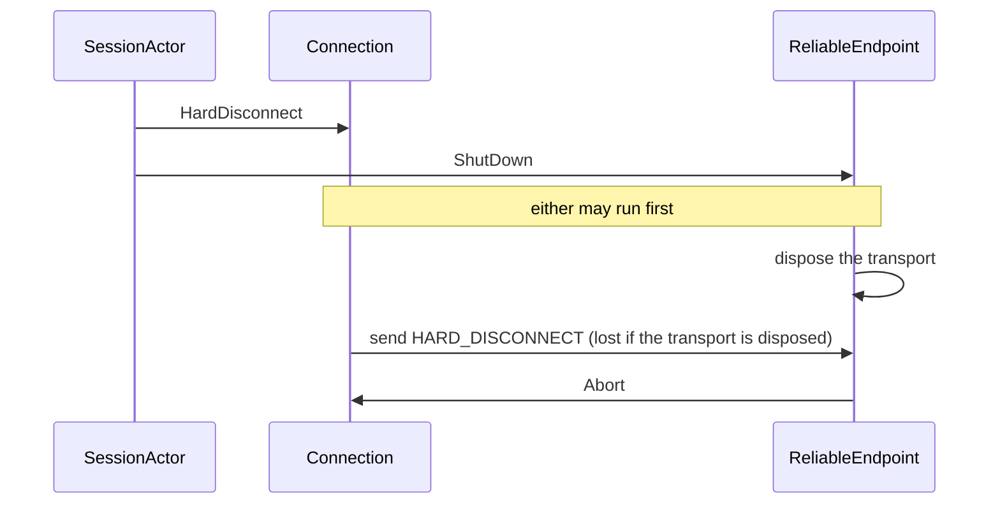
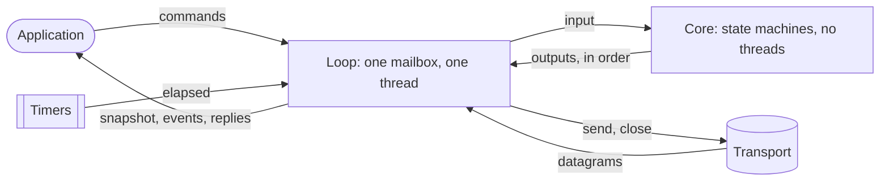

# Otsuki's threading
A proposal for making races impossible in [Otsuki](../Otsuki/Aigamo.Otsuki) by construction. The actors removed the locks around the protocol state, but the state is split over several mailboxes, and every message that crosses from one mailbox to another is a place where two things can happen in either order. This document explains why actors still race, lists where Otsuki does today, explains why such races are hard to find, and proposes a protocol core with no threads at all, driven by one loop, with tests that choose every order instead of waiting for one.

This is a proposal, not a final design. [Open questions](#open-questions) lists what still needs to be decided.

## Today
[The README](../Otsuki/Aigamo.Otsuki/README.md#design) describes the design. In short:

- [`SessionActor`](../Otsuki/Aigamo.Otsuki/Session/SessionActor.cs) runs the core protocol, and publishes a `SessionSnapshot` that [`Peer`](../Otsuki/Aigamo.Otsuki/Peer.cs) reads from the application's threads.
- [`ReliableEndpoint`](../Otsuki/Aigamo.Otsuki/Reliable/ReliableEndpoint.cs) owns the transport and the connection table, and routes datagrams.
- Each [`Connection`](../Otsuki/Aigamo.Otsuki/Reliable/Connection.cs) is an actor of its own, one per partner, and sends its frames by calling the transport directly.

Three kinds of actors, one mailbox each, each on the thread pool.

## Why actors still race
An actor guarantees one thing: its own state is touched by one message at a time. So two messages to the same actor never interleave, and its state needs no lock. That rules out *data races*, two threads touching the same memory at once, but only for state that one actor really owns.

It guarantees nothing about anything else:

- **No order between mailboxes.** The only order is between one sender and one receiver: if A posts M1 and then M2 to B, B sees M1 first. Erlang, built on actors, promises the same and no more ([Processes](https://www.erlang.org/doc/system/ref_man_processes.html)). When A posts to B and to C, B and C run in either order, and so does whatever they do next.
- **No atomicity across actors.** An operation that changes the state of two actors is two messages, and other messages can run between them.
- **No ownership of what is outside the actors.** An object that two actors both call, or a field that a method reads from another actor's thread, is shared memory again, and the actor model does not see it.

So races remain, of a different kind: not two threads in one piece of memory, but two messages in an order their author did not expect. Otsuki has each kind:

| Race | Kind |
| --- | --- |
| [The snapshot and the answer](#the-snapshot-and-the-answer) | No order between two channels out of one actor, read by another thread |
| [The goodbye and the socket](#the-goodbye-and-the-socket) | No order between mailboxes: one actor posts to two others |
| [The signing mode](#the-signing-mode) | A field read from another actor's thread |
| [The shared transport](#the-shared-transport) | An object that several actors call |

Fewer, larger actors make fewer such places, but any two mailboxes make at least one. The only design without them has no second mailbox for the protocol state, and no threads inside the protocol at all ([The proposal](#the-proposal)).

## Where Otsuki races
### The snapshot and the answer
`await peer.ConnectAsync(...)` followed by `peer.LocalEndPoint` must see the endpoint. The session completes the command's `TaskCompletionSource` and publishes the snapshot, and the caller's continuation runs on the thread pool as soon as the task completes, so publishing must come first. It did not once; [`ICanConnect`](../Otsuki/Aigamo.Otsuki/Session/Transitions/ICanConnect.cs) now calls `Publish()` before `TrySetResult()`.

The order is still a convention that each transition keeps by itself. [`ICanHost`](../Otsuki/Aigamo.Otsuki/Session/Transitions/ICanHost.cs) completes `HostAsync` without calling `Publish()`, and is right only because `MarkCreated` publishes on the way. The `Publish()` at the end of `SessionActor.Receive` runs after every transition, so it is always too late to cover a completion. A new transition that completes a task before anything publishes brings the bug back, and no test is likely to catch it, because the window is a few microseconds.

### The goodbye and the socket
When joining fails, [`FailConnect`](../Otsuki/Aigamo.Otsuki/Session/SessionActor.cs) posts `HardDisconnect` to each connection, then `ShutDown` to the endpoint:



The connection and the endpoint run on different threads, so the endpoint can dispose the transport before the connection sends HARD_DISCONNECT. The send then fails silently: [`UdpDatagramTransport`](../Otsuki/Aigamo.Otsuki/Transport/UdpDatagramTransport.cs) catches `ObjectDisposedException`, and [`StreamDatagramTransport`](../Otsuki/Aigamo.Otsuki/Transport/StreamDatagramTransport.cs) returns when it is disposed. The partner learns that we left only when its own time-out runs out.

Even when the connection wins, the endpoint's `Abort` follows right behind `HardDisconnect` in the connection's mailbox, so the connection leaves `HardDisconnecting` before its retry timer ([`ICanHardDisconnect`](../Otsuki/Aigamo.Otsuki/Reliable/Transitions/ICanHardDisconnect.cs)) can resend. HARD_DISCONNECT is sent at most once, and not at all when the endpoint wins.

### The signing mode
[`ReliableEndpoint.Connect`](../Otsuki/Aigamo.Otsuki/Reliable/ReliableEndpoint.cs) is called on the session's thread, and its comment says that it only reads immutable state. It reads `_signing`, which `SetSigning` writes on the endpoint's thread. The session posts `SetSigning` when it hosts or receives DN_SEND_CONNECT_INFO, and connects to other peers only after later messages arrive, so in practice the write is long done before the read. Nothing guarantees it, though. If an outbound connection read the old value, `PacketSigning.None`, it would accept whatever signing the listener offers, which is the downgrade that `OfferedSigning` exists to prevent.

### The shared transport
[`IDatagramTransport`](../Otsuki/Aigamo.Otsuki/Transport/IDatagramTransport.cs) requires `Send` to be safe from several threads at once, because every connection calls it from its own loop, and the endpoint from its own. A UDP socket allows that. `StreamDatagramTransport` keeps a table of links, which `Send` adds to from the connections' threads while the link tasks remove from it and the connector adds accepted streams, so it guards the table with a `lock`. The README's threading summary says that there are no locks anywhere in the library, which is no longer true.

The lock is a symptom: the transport is state that several actors share instead of one owning it.

### The tests wait on real time
Every test runs real actors on the thread pool, with protocol timings shortened to milliseconds, and polls for events with `Task.Delay` up to a 10-second time-out ([`EventLog`](../Otsuki/Aigamo.Otsuki.Tests/EventLog.cs)). A test sees whichever interleaving the thread pool happens to produce, so none of the orders above can be forced, and a failure that depends on one shows up as a rare flake. The `TimeProvider` is injected everywhere but never faked.

## Why these are hard to find
These races were found by tracing one path with a question in mind, not by reading the code or by its tests. What hides them applies to any reviewer, a person or a coding agent:

- **No line is wrong.** Each handler is correct on its own. The goodbye race is in the order between `FailConnect`, `ReliableEndpoint.HandleShutDown`, `ICanHardDisconnect` and the transport's `Dispose`: four files, none of which mentions the others' timing.
- **The bug is something missing.** Nothing in the code says "these two may run in either order"; seeing it takes knowing that mailboxes are ordered only per sender and receiver, and asking it of every pair of posts.
- **The names and comments say it is safe.** "Actor", "only reads immutable state", "there are no locks anywhere". A reader who trusts them, as reading code mostly requires, stops looking.
- **The tests pass.** The thread pool picks almost always the same order, and the window is microseconds. A failure that does appear looks like a slow machine, and the easy fix is a longer time-out.
- **The orders multiply.** Reading follows one order; n messages in flight have up to n! orders. Checking them all takes a tool that runs them all, not more careful reading.

Coding agents are weaker here than at most bugs, because they lean on exactly the two things that fail: reading code locally, and running the tests. One study of LLM-written Java found concurrency bugs far more often for one model than for the others ([arXiv 2508.14727](https://arxiv.org/abs/2508.14727)); the CONCUR benchmark judges generated concurrent code by model checking, because tests do not catch these bugs ([arXiv 2603.03683](https://arxiv.org/abs/2603.03683)). The same code that an agent wrote and reviewed may be correct line by line and still race.

So the answer is not a more careful review, by a person or an agent, but code where these races cannot be written, and a compiler that refuses the code that could.

## Goals
- **No concurrency in the protocol.** The protocol's code never runs on two threads, and cannot: the compiler refuses the types that would let it. Data races and races between mailboxes inside the protocol are then impossible, not merely absent.
- **Effects in the order they were decided.** What the protocol decides to do (send, close, publish, complete) is carried out in that order, by one thread.
- **The reply after the snapshot, structurally.** No protocol code can complete a task; one place in the loop does, after publishing.
- **Tests choose the order.** Tests run peers and the network on one thread with a virtual clock, deterministically, and can try many orders of the same inputs.
- **The protocol does not change.** The transitions, the wire format and the behavior that the existing tests check stay as they are.

## The proposal
### A core without threads
The protocol becomes a *core*: the session's and the connections' state machines, with no I/O, no timers, no tasks and no threads. It is driven from outside:

```
core.Handle(input, now) → outputs
```

- **Inputs**: a datagram from an address, a timer that elapsed, a command from the application (with a request ID instead of a `TaskCompletionSource`).
- **Outputs**, in order: send a datagram, start or cancel a timer, close the transport, publish a snapshot, raise an event, reply to a request.
- **Time** is an input (`now`), so the core reads no clock.

Inside one call, the core runs the input and everything it causes to completion: a connection that reports to the session puts the report on an internal queue, which the core drains before returning, as the session's mailbox does today. So the core is one sequential function from one state to the next. Two inputs never interleave, because nothing can call it twice at once ([the loop](#one-loop) is its only caller).

This is the *sans-I/O* style of protocol libraries such as [quinn-proto](https://docs.rs/quinn-proto) (QUIC) and [h11](https://h11.readthedocs.io) (HTTP/1.1), where the protocol is a state machine fed with bytes and time, and the application owns the sockets and threads.

### One loop


The *shell* is one actor, the loop. Its mailbox takes every input: datagrams from the transport's receive loop, timer firings, the application's commands. For each, it calls the core and then carries out the outputs in order, on its own thread. It then publishes the final snapshot and completes the replies, in that order, in one place.

How each race goes away:

- **The snapshot and the answer.** The core cannot complete a task; it emits a reply, and the loop completes replies only after publishing.
- **The goodbye.** The core emits *send HARD_DISCONNECT* before *close*, and the loop carries them out in that order on one thread. A stream transport's close finishes the datagrams already queued on its links instead of cancelling them.
- **The signing mode.** It is part of the core's state.
- **The shared transport.** Only the loop calls `Send`, so `IDatagramTransport` drops the requirement that `Send` be safe from several threads.

What stays nondeterministic is the order in which inputs arrive: which datagram comes first, whether a timer fires before a reply. That is the network's real nondeterminism, not a race in the code. The core must handle every order, as the specifications require, and the [simulation tests](#deterministic-simulation-tests) try many.

What it costs: the connections no longer run in parallel ([Performance](#performance)).

### Performance
Nothing is measured yet. For a session of a few peers, what the structure says:

- **The serial part is already serial.** Every payload that reaches the application goes through `SessionActor`, one message at a time. Running connections in parallel only spreads the reliable layer's work (decoding, acknowledging, reassembling, signing).
- **Fewer hops.** Today a received datagram crosses three mailboxes, endpoint, connection, then session, and each crossing is a channel write, a record allocated, and a thread-pool thread woken. In one loop it crosses one. The latency from the socket to the event should go down, not up.
- **The loop must not block.** A UDP send does not block in practice, and a stream transport only queues the datagram.

Whether one loop is enough for hundreds or thousands of clients is not known, for today's code either: its path through the session is just as serial. A benchmark records the latency from a datagram received to its event and the throughput of a session of 2 to 8 peers on loopback, today and after each step.

### The compiler keeps the core single-threaded
The core moves to an assembly of its own, `Aigamo.Otsuki.Core`, which the shell references. In it:

- [BannedApiAnalyzers](https://github.com/dotnet/roslyn-analyzers/blob/main/src/Microsoft.CodeAnalysis.BannedApiAnalyzers/BannedApiAnalyzers.Help.md) refuse the types that start or share work across threads: `Task`, `TaskCompletionSource`, `Thread`, `ThreadPool`, `Timer`, `TimeProvider`, `Channel`, `Monitor`, `Interlocked`, `Volatile`, the concurrent collections, and the socket types.
- A rule in [the analyzers project](../Otsuki/Aigamo.Otsuki.Analyzers) reports `lock`, `async` and `await`, and mutable `static` fields.

A race inside the core then needs code that does not compile. This is what "certain" means here: not a property that tests or reviews looked for and did not find, but one the build checks every time.

The shell stays small: the loop, the timers that post to it, and the transports. `StreamDatagramTransport` becomes a loop of its own for its link table, so that its link tasks and the connector post instead of taking the lock, and the analyzer reports locks in the shell too, outside the actor base.

### Deterministic simulation tests
Since the core does nothing by itself, a test can run several peers' cores, a simulated network and a virtual clock on one thread: deliver a datagram, fire the timers that are due, check the outputs. No real time passes, so a time-out of 30 seconds takes no time, and a test given the same seed does the same thing every time.

On top of that:

- **Orders of the same inputs.** A test can deliver the same datagrams and timer firings in every order, or in many random orders with recorded seeds, and check the same invariants each time. A failing seed is a failing test that reproduces.
- **Outputs in order.** The goodbye becomes an assertion on one list: *send HARD_DISCONNECT* comes before *close*.
- **The specifications' samples** are fed to the core byte for byte, as the protocol tests do today.

The current tests are ported to the simulation. A few stay on real threads and real UDP, to check the shell.

### From today's code
The transitions in `Reliable/Transitions` and `Session/Transitions` do not change: they call methods of `Connection` and `SessionActor`, and those methods change what they do.

| Today | In the core |
| --- | --- |
| `Connection.Transmit` calls the transport | Adds a *send* output |
| `ActorTimer` creates a `TimeProvider` timer | Adds a *start timer* or *cancel timer* output; the loop's timer posts the elapsed input with the generation |
| `IConnectionObserver` posts to the session's mailbox | Puts the report on the core's internal queue |
| `Emit`, `Publish` | Add *event* and *snapshot* outputs, in the same order as today |
| `TaskCompletionSource.TrySetResult` | Adds a *reply* output for the request ID |
| `Connection.Timestamp` reads the `TimeProvider` | Reads the input's `now` |
| `ReliableEndpoint`'s connection table and routing | Part of the core |

## Steps
Each step is one commit, with the tests passing after it, and the benchmark run again after it.

0. **The benchmark**, run on today's code ([Performance](#performance)).
1. **Signing passed to `Connect`** by the session, which knows its flags, instead of read from the endpoint.
2. **Replies after the snapshot**: transitions hand completions to the session, which completes them after the final `Publish()`.
3. **Connections into the session's mailbox**: `Connection` no longer an actor; the connection table and routing move from `ReliableEndpoint`. The goodbye race is gone.
4. **The transport owned by the loop**: sends and the close from the loop's thread, the close finishing queued datagrams; `IDatagramTransport`'s threading requirement dropped.
5. **Effects as outputs**: transmit, timers, events, snapshots and replies become outputs that the loop carries out; time becomes an input.
6. **The core's own assembly**, with the banned APIs and the analyzer rule.
7. **The simulation**: virtual clock, simulated network, seeds; the current tests ported, and tests of many orders added.
8. **`StreamDatagramTransport` without the lock**, and the analyzer applied to the shell.
9. **The README's design section** rewritten.

Steps 1 and 2 are small and independent, and could land first. Step 3 alone fixes every race found so far; steps 5 and 6 make new ones impossible to write.

## Not covered
- The game's own threads, such as the UI thread and the game thread sharing dialog state. They are outside Otsuki.
- The Bluetooth connectors ([Bluetooth.md](Bluetooth.md)), which run on the platforms' own threads and run loops. They only open and accept streams, and post them to the transport's loop.

## Open questions
- **Waiting for the hard disconnect.** Should a failed join keep the transport open until each connection has resent HARD_DISCONNECT as [`ICanRepeatHardDisconnect`](../Otsuki/Aigamo.Otsuki/Reliable/Transitions/ICanRepeatHardDisconnect.cs) does, or is one send enough before closing?
- **Snapshots per event.** Today a snapshot is published before each event that needs it. Should the core keep emitting one per event, or one per input, with events carrying what their handlers need?
- **How far to go.** Steps 1 to 4 fix the known races with the actors' shape mostly kept; steps 5 to 7 are a larger change of `SessionActor` (about 1,600 lines). Is the guarantee worth it now, or after the next feature?
- **The simulation's reach**: random orders with seeds, or exhaustive orders for small cases, or both?
- **Keeping the threaded tests**: which of the existing tests stay on real threads once the simulation exists?
