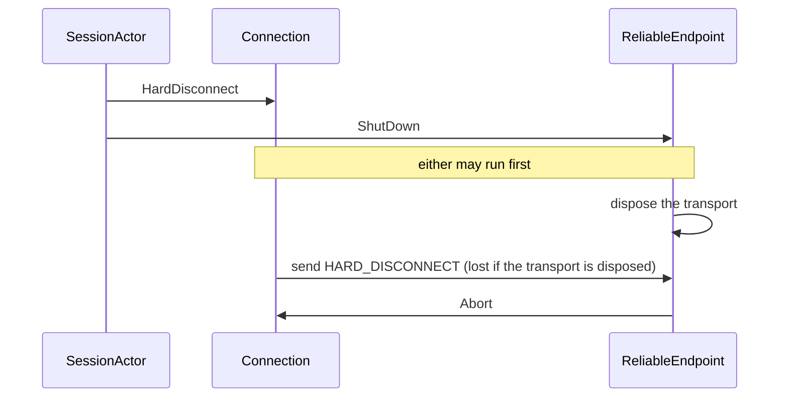
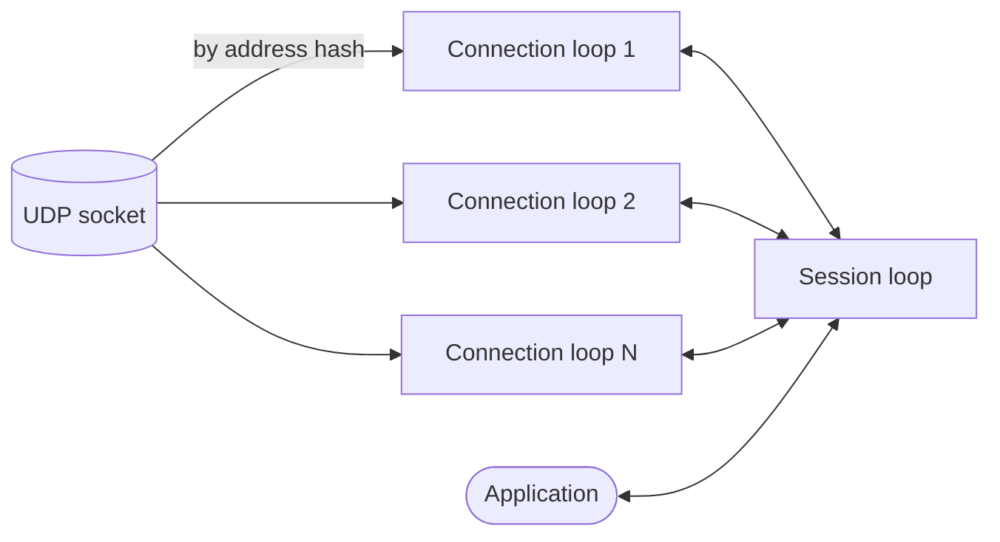

# Otsuki's threading
A proposal for making races impossible in [Otsuki](../Otsuki/Aigamo.Otsuki) by construction. The actors removed the locks around the protocol state, but the state is split over several mailboxes, and every message that crosses from one mailbox to another is a place where two things can happen in either order. This document explains why actors still race, lists where Otsuki does today, explains why such races are hard to find, and proposes a protocol core with no threads at all, driven by one loop, with tests that choose every order instead of waiting for one. It then shards that loop so that a server can hold 10,000 clients and more with no locks in Otsuki's code, and says how to verify it by measuring.

This is a proposal, not a final design. [Open questions](#open-questions) lists what still needs to be decided. Part of it is done: [Progress](#progress) says what, with what the load tests measured.

## Progress
Done so far, each step a commit with Otsuki's tests passing, and measured with the load test ([`Aigamo.Otsuki.LoadTest`](../Otsuki/Aigamo.Otsuki.LoadTest)):

| Step | State |
| --- | --- |
| 0. The load test | Done: a server and processes of clients over UDP, reporting each second the messages, datagrams on both sides, latency, CPU, garbage, lock contentions, the thread pool and every mailbox's depth (`Peer.Queues`). |
| 1. Signing passed to `Connect` | Done before this plan's steps ([The signing mode](#the-signing-mode)). |
| 2. Replies after the snapshot | Done: transitions answer through `SessionActor.Reply` and `Fail`, which complete the tasks once the message is done and the snapshot published; a regression test checks it twenty times over. |
| 3. The snapshot updated, not rebuilt | Done: only the players and groups marked changed are made again, and nothing is published when nothing changed. A debug build checks after each publish that the snapshot equals one made from scratch. |
| 4, 12. Connections out of their own actors | Done differently from the plan: the connections of a peer run on *connection loops*, as many as `PeerOptions.ConnectionLoops` (1 by default), a hash of the partner's address choosing the loop; the session stays an actor of its own, and the endpoint only owns the transport and coordinates the shutdown in two phases. The plan's single loop for session and connections is not done ([What is left](#what-is-left)). |
| 5. The transport owned by the loop | Partly: each loop sends on its own UDP socket, all bound to the same port (`UdpDatagramTransport(endPoint, sockets)`), so that the loops do not wait for each other in the kernel. |
| 10. Timers in the loop | Done: a loop keeps its connections' deadlines in one priority queue and arms one runtime timer for the nearest; a restart that only moves a deadline later costs nothing. |
| 11. The mailbox without locks | Not needed so far: Otsuki's code takes no lock to post or receive (`ConcurrentQueue` and `Interlocked`; the queue's own lock is taken only when a segment of it fills), and the runtime counts 1 to 8 contended locks a second in a whole server process under load, which is not where its time goes. |
| 13. Receiving across the cores | Partly: every socket of the port receives; macOS gives a port's datagrams to one socket, so on macOS one receive loop takes them all. |
| 14. No allocation per datagram | Partly: the dispatch of every frame and of the data path takes a `switch` ahead of the generated `Match`, whose delegates were made at each call, and acknowledgments take a loop in place of closures; the garbage per datagram fell from about 15 KB to about 1 KB. Pooled buffers are not done. |
| 15. The data path around the session | Not done: no load that this machine can carry has made the session the bottleneck. |
| 8. The simulation | Partly: a `ManualScheduler` (`PeerOptions.Scheduler`) runs the peers' actors one message at a time on the test's thread, in an order a seed chooses, with a manual clock and a simulated network that delivers each datagram as a step of its own ([`SimulationTests`](../Otsuki/Aigamo.Otsuki.Tests/SimulationTests.cs)). It tries 100 orders of a client/server session that joins, sends and closes, and 100 of a rejected join, which must send nothing after its transport is disposed: with the old goodbye race put back, that test fails on its first seed. A seed takes nearly the same order again, not exactly: the session's GUID and the hash order of a set of connections still change from run to run. The cores of steps 6 and 7 are also tested alone, with no thread: [`ConnectionLoopCoreTests`](../Otsuki/Aigamo.Otsuki.Tests/ConnectionLoopCoreTests.cs) give two loops' cores datagrams and times, and check that a goodbye sends every HARD_DISCONNECT before the loop is done; with the goodbye cut short again, it fails. |
| 6. Effects as outputs | Done, for the session and for each connection loop: [`SessionCore`](../Otsuki/Aigamo.Otsuki.Core/Session/SessionCore.cs) and [`ConnectionLoopCore`](../Otsuki/Aigamo.Otsuki.Core/Reliable/ConnectionLoopCore.cs) take each input with the time, keep their timers as deadlines, and do everything outside through an outputs interface that the actor running them implements ([`ISessionOutputs`](../Otsuki/Aigamo.Otsuki.Core/Session/ISessionOutputs.cs), [`IConnectionLoopOutputs`](../Otsuki/Aigamo.Otsuki.Core/Reliable/ConnectionLoopCore.cs)). A command carries a `Completion` that the core can only name in an answer, given after the snapshot. The session holds a connection only by an immutable handle ([`Connection`](../Otsuki/Aigamo.Otsuki.Core/Reliable/Connection.cs)); the state is the loop's `ReliableConnection`. See [How steps 6 and 7 were done](#how-steps-6-and-7-were-done). |
| 7. The core's assembly | Done: [`Aigamo.Otsuki.Core`](../Otsuki/Aigamo.Otsuki.Core), which does not reference the actors, and a rule of [the analyzers](../Otsuki/Aigamo.Otsuki.Analyzers/CoreAnalyzer.cs) that reports, in it and in `Aigamo.Otsuki.Messages`, the threads, tasks, timers, sockets and actors, a read of a clock, `async`, and static state that can change (OTSUKI0004, OTSUKI0005). It found a DNS lookup inside the protocol and three static fields of the wire formats that could be reassigned. |
| 9. `StreamDatagramTransport` without the lock | Done before this plan's steps: its links are an actor's. |
| 17. The README | Done: its design section describes the loops, the mailbox and its scheduler, the snapshot, the simulation and the load test. |
| Also | A broadcast is one message per loop, not one per client; a send that reports no completion (`SendFlags.NoComplete`) is no longer followed by the session, and its connections report nothing back. |

### Measurements
On one Apple M2 (4 performance and 4 efficiency cores, 16 GB), macOS, over loopback, with the clients in 1 to 5 processes of their own on the same machine, each client a whole Otsuki `Client`. Each client sends 30 guaranteed messages of 32 bytes a second and the server sends 20 updates a second to every client, unless the run says otherwise; the server has 4 loops and 4 sockets once those exist. The values are the medians of the seconds once every client has joined and 3 more have passed, or their means for the pauses and the contentions; p99 is the worst second's.

| Run | Clients | Messages in/s | Messages out/s | Datagrams in / out per s | p99 in (ms) | p99 updates (ms) | Server CPU (cores) | Allocated (MB/s) | GC pause (ms/s) | Lock contentions/s |
| --- | --- | --- | --- | --- | --- | --- | --- | --- | --- | --- |
| Before | 1,000 | 4,451 | 20,000 | 32,890 / 32,854 | 13,096 | 12,145 | 2.28 | 677 | 48.9 | 15.0 |
| Snapshot updated (3) | 1,000 | 29,999 | 20,000 | 49,975 / 50,003 | 72 | 79 | 1.61 | 179 | 8.5 | 3.8 |
| Loops (4, 12) | 1,000 | 30,067 | 20,000 | 49,944 / 49,928 | 107 | 213 | 1.38 | 217 | 10.4 | 0.9 |
| Loop timers (10) | 1,000 | 30,018 | 20,000 | 49,998 / 49,998 | 109 | 131 | 1.14 | 207 | 7.6 | 8.1 |
| No delegates per message (14) | 1,000 | 29,953 | 20,000 | 49,953 / 49,953 | 119 | 74 | 1.13 | 93 | 5.1 | 2.7 |
| 1 message and 1 update a second | 10,000 | 10,006 | 10,000 | 19,810 / 22,868 | 852 | 950 | 0.72 | 40 | 3.2 | 4.0 |

What the measurements found, in the order they found it:

1. **The snapshot was rebuilt after every message.** Before, the server took a few hundred clients: past that, the session spent its time copying the name table, its mailbox grew without bound, and the latency reached seconds. Updating the snapshot by what changed took 1,000 clients to a steady state.
2. **The mailbox hops, the timers and the sends.** At 2,000 and more, the server's time went to `sendto` on one socket shared by the threads of every connection (48% of its threads' time, with the connections already on 4 loops), `recvfrom` (11%), and the runtime's timer queue lock (8%), taken by every restart of a connection's timer. The loops, a socket per loop and the loop timers took the server from 1.6 to 1.1 cores at 1,000 clients.
3. **The delegates of `Match`.** The generated `Match` takes a delegate per kind, made again at every call: about 17 for each message to a connection, about 30 for each message to the session. A `switch` ahead of it, for the kinds of every frame, halved the garbage.
4. **The machine, not the server.** Past about 2,000 clients at 30 messages a second, or about 9,000 at 3, the clients stopped getting their acknowledgments in time and gave up, while the server's mailboxes stayed empty and it used under 2 cores. The system's own counters show why: in one such run the loopback interface passed 3.15 million packets, and IP received 1.41 million of them; the rest were dropped between the two, with every core busy with the server, five processes of clients and the system. Over loopback, with the clients on the same 8 cores, half of them efficiency cores, the system is what fails first.
5. **10,000 clients.** At 1 message and 1 update a second each, 10,000 clients joined at 500 a second and stayed for the rest of the minute, none lost: the server used 0.7 of a core, allocated 40 MB a second, kept its mailboxes empty, and the runtime counted 4 contended locks a second in the whole process. Otsuki's code takes none, as the analyzer checks; the runtime's types take theirs (the thread pool, the sockets, the timers), and the trace did not tell them apart ([No locks on the hot path](#no-locks-on-the-hot-path)). The p99 latency of about 0.9 s comes from the starved processes of clients and the system's drops, not from the server's queues.

6. **The core costs nothing measurable.** Steps 6 and 7 were measured against the commit before them, at 1,000 clients, the two runs taking turns twice, while another process used 3.6 of the machine's cores: before, 1.33 and 1.27 server cores and 94 and 87 MB of garbage a second; with the core, 1.25 and 0.94 cores and 90 and 83 MB. The latency of both was in seconds, from the machine's load; the table above was measured on an idle one.

So the architecture carries 10,000 connections on one server here, at the message rates this machine's loopback can carry. Higher rates at 10,000 need the clients on other machines, which the load test supports (`clients --server HOST:PORT`).

### What is left
- **Between the loops.** Inside each core a race needs code that does not build. Between the session and the connection loops there are mailboxes, whose orders the rules of [Races between loops](#races-between-loops) keep, checked by the simulation in two scenarios: host migration, peer-to-peer meshes and lost datagrams are still to simulate, and a seed should take exactly the same order, which needs the GUIDs and the sets of connections made deterministic. The compiler does not check that what one core hands another is immutable: the handle and the messages are, by review.
- **The DNS lookup** of a peer's address that is a name, not an IP address, still blocks the session's thread, as it did; it is now an output (`ResolveHostname`), so it shows.
- **Step 15**, the data path around the session, and **pooled buffers** (14): to do once a load shows the session or the garbage collector as the limit, which needs clients on other machines.
- **Batched system calls** (16): only if those measurements ask for them.

## The design this started from
As it was before the steps of [Progress](#progress). [The README](../Otsuki/Aigamo.Otsuki/README.md#design) describes it. In short:

- [`SessionActor`](../Otsuki/Aigamo.Otsuki/Session/SessionActor.cs) runs the core protocol, and publishes a `SessionSnapshot` that [`Peer`](../Otsuki/Aigamo.Otsuki/Peer.cs) reads from the application's threads.
- [`ReliableEndpoint`](../Otsuki/Aigamo.Otsuki/Reliable/ReliableEndpoint.cs) owns the transport and the connection table, and routes datagrams.
- Each [`Connection`](../Otsuki/Aigamo.Otsuki.Core/Reliable/ReliableConnection.cs) is an actor of its own, one per partner, and sends its frames by calling the transport directly.

Three kinds of actors, one mailbox each, each on the thread pool.

## Why actors still race
An actor guarantees one thing: its own state is touched by one message at a time. So two messages to the same actor never interleave, and its state needs no lock. That rules out *data races*, two threads touching the same memory at once, but only for state that one actor really owns.

It guarantees nothing about anything else:

- **No order between mailboxes.** The only order is between one sender and one receiver: if A posts M1 and then M2 to B, B sees M1 first. Erlang, built on actors, promises the same and no more ([Processes](https://www.erlang.org/doc/system/ref_man_processes.html)). When A posts to B and to C, B and C run in either order, and so does whatever they do next.
- **No atomicity across actors.** An operation that changes the state of two actors is two messages, and other messages can run between them.
- **No ownership of what is outside the actors.** An object that two actors both call, or a field that a method reads from another actor's thread, is shared memory again, and the actor model does not see it.

So races remain, of a different kind: not two threads in one piece of memory, but two messages in an order their author did not expect. Otsuki has each kind:

| Race | Kind |
| --- | --- |
| [The snapshot and the answer](#the-snapshot-and-the-answer) | No order between two channels out of one actor, read by another thread |
| [The goodbye and the socket](#the-goodbye-and-the-socket) | No order between mailboxes: one actor posts to two others |
| [The signing mode](#the-signing-mode) | A field read from another actor's thread |
| [The shared transport](#the-shared-transport) | An object that several actors call |

Fewer, larger actors make fewer such places, but any two mailboxes make at least one. The only design without them has no second mailbox for the protocol state, and no threads inside the protocol at all ([The proposal](#the-proposal)).

## Where Otsuki races
### The snapshot and the answer
*Fixed by step 2: the session answers commands only after it has published the snapshot.*

`await peer.ConnectAsync(...)` followed by `peer.LocalEndPoint` must see the endpoint. The session completes the command's `TaskCompletionSource` and publishes the snapshot, and the caller's continuation runs on the thread pool as soon as the task completes, so publishing must come first. It did not once; [`ICanConnect`](../Otsuki/Aigamo.Otsuki.Core/Session/Transitions/ICanConnect.cs) now calls `Publish()` before `TrySetResult()`.

The order is still a convention that each transition keeps by itself. [`ICanHost`](../Otsuki/Aigamo.Otsuki.Core/Session/Transitions/ICanHost.cs) completes `HostAsync` without calling `Publish()`, and is right only because `MarkCreated` publishes on the way. The `Publish()` at the end of `SessionActor.Receive` runs after every transition, so it is always too late to cover a completion. A new transition that completes a task before anything publishes brings the bug back, and no test is likely to catch it, because the window is a few microseconds.

### The goodbye and the socket
*Fixed: the endpoint keeps its transport until its last connection has terminated, and a connection that is hard-disconnecting finishes its retries before it does; with the loops, the shutdown is posted to every loop after the goodbyes, and the transport is disposed once every loop has reported that its last connection has ended.*

When joining fails, [`FailConnect`](../Otsuki/Aigamo.Otsuki.Core/Session/SessionCore.cs) posts `HardDisconnect` to each connection, then `ShutDown` to the endpoint:



The connection and the endpoint run on different threads, so the endpoint can dispose the transport before the connection sends HARD_DISCONNECT. The send then fails silently: [`UdpDatagramTransport`](../Otsuki/Aigamo.Otsuki/Transport/UdpDatagramTransport.cs) catches `ObjectDisposedException`, and [`StreamDatagramTransport`](../Otsuki/Aigamo.Otsuki/Transport/StreamDatagramTransport.cs) returns when it is disposed. The partner learns that we left only when its own time-out runs out.

Even when the connection wins, the endpoint's `Abort` follows right behind `HardDisconnect` in the connection's mailbox, so the connection leaves `HardDisconnecting` before its retry timer ([`ICanHardDisconnect`](../Otsuki/Aigamo.Otsuki.Core/Reliable/Transitions/ICanHardDisconnect.cs)) can resend. HARD_DISCONNECT is sent at most once, and not at all when the endpoint wins.

### The signing mode
*Fixed: the session gives `Connect` its own signing mode, and the loops keep theirs for inbound connections.*

[`ReliableEndpoint.Connect`](../Otsuki/Aigamo.Otsuki/Reliable/ReliableEndpoint.cs) is called on the session's thread, and its comment says that it only reads immutable state. It reads `_signing`, which `SetSigning` writes on the endpoint's thread. The session posts `SetSigning` when it hosts or receives DN_SEND_CONNECT_INFO, and connects to other peers only after later messages arrive, so in practice the write is long done before the read. Nothing guarantees it, though. If an outbound connection read the old value, `PacketSigning.None`, it would accept whatever signing the listener offers, which is the downgrade that `OfferedSigning` exists to prevent.

### The shared transport
*Fixed for streams: `StreamDatagramTransport`'s links are an actor's, with no lock. A UDP transport is still sent on from several threads, the loops', which the system allows; with a socket per loop, no two loops share one.*

[`IDatagramTransport`](../Otsuki/Aigamo.Otsuki/Transport/IDatagramTransport.cs) requires `Send` to be safe from several threads at once, because every connection calls it from its own loop, and the endpoint from its own. A UDP socket allows that. `StreamDatagramTransport` keeps a table of links, which `Send` adds to from the connections' threads while the link tasks remove from it and the connector adds accepted streams, so it guards the table with a `lock`. The README's threading summary says that there are no locks anywhere in the library, which is no longer true.

The lock is a symptom: the transport is state that several actors share instead of one owning it.

### The tests wait on real time
*Partly fixed: the simulation tests run on a manual clock and choose the order ([Progress](#progress)); the other tests still run on real threads and real time.*

Every test runs real actors on the thread pool, with protocol timings shortened to milliseconds, and polls for events with `Task.Delay` up to a 10-second time-out ([`EventLog`](../Otsuki/Aigamo.Otsuki.Tests/EventLog.cs)). A test sees whichever interleaving the thread pool happens to produce, so none of the orders above can be forced, and a failure that depends on one shows up as a rare flake. The `TimeProvider` is injected everywhere but never faked.

## Why these are hard to find
These races were found by tracing one path with a question in mind, not by reading the code or by its tests. What hides them applies to any reviewer, a person or a coding agent:

- **No line is wrong.** Each handler is correct on its own. The goodbye race is in the order between `FailConnect`, `ReliableEndpoint.HandleShutDown`, `ICanHardDisconnect` and the transport's `Dispose`: four files, none of which mentions the others' timing.
- **The bug is something missing.** Nothing in the code says "these two may run in either order"; seeing it takes knowing that mailboxes are ordered only per sender and receiver, and asking it of every pair of posts.
- **The names and comments say it is safe.** "Actor", "only reads immutable state", "there are no locks anywhere". A reader who trusts them, as reading code mostly requires, stops looking.
- **The tests pass.** The thread pool picks almost always the same order, and the window is microseconds. A failure that does appear looks like a slow machine, and the easy fix is a longer time-out.
- **The orders multiply.** Reading follows one order; n messages in flight have up to n! orders. Checking them all takes a tool that runs them all, not more careful reading.

Coding agents are weaker here than at most bugs, because they lean on exactly the two things that fail: reading code locally, and running the tests. One study of LLM-written Java found concurrency bugs far more often for one model than for the others ([arXiv 2508.14727](https://arxiv.org/abs/2508.14727)); the CONCUR benchmark judges generated concurrent code by model checking, because tests do not catch these bugs ([arXiv 2603.03683](https://arxiv.org/abs/2603.03683)). The same code that an agent wrote and reviewed may be correct line by line and still race.

So the answer is not a more careful review, by a person or an agent, but code where these races cannot be written, and a compiler that refuses the code that could.

## Goals
- **No concurrency in the protocol.** The protocol's code never runs on two threads, and cannot: the compiler refuses the types that would let it. Data races and races between mailboxes inside the protocol are then impossible, not merely absent.
- **Effects in the order they were decided.** What the protocol decides to do (send, close, publish, complete) is carried out in that order, by one thread.
- **The reply after the snapshot, structurally.** No protocol code can complete a task; one place in the loop does, after publishing.
- **Tests choose the order.** Tests run peers and the network on one thread with a virtual clock, deterministically, and can try many orders of the same inputs.
- **Many clients, no locks.** A server holds 10,000 active clients and more, with no locks on the hot path of Otsuki's code, shown by load tests rather than claimed ([Scaling to many clients](#scaling-to-many-clients)).
- **The protocol does not change.** The transitions, the wire format and the behavior that the existing tests check stay as they are.

## The proposal
### A core without threads
The protocol becomes a *core*: the session's and the connections' state machines, with no I/O, no timers, no tasks and no threads. It is driven from outside:

```
core.Handle(input, now) → outputs
```

- **Inputs**: a datagram from an address, a timer that elapsed, a command from the application (with a request ID instead of a `TaskCompletionSource`).
- **Outputs**, in order: send a datagram, start or cancel a timer, close the transport, publish a snapshot, raise an event, reply to a request.
- **Time** is an input (`now`), so the core reads no clock.

Inside one call, the core runs the input and everything it causes to completion: a connection that reports to the session puts the report on an internal queue, which the core drains before returning, as the session's mailbox does today. So the core is one sequential function from one state to the next. Two inputs never interleave, because nothing can call it twice at once ([the loop](#one-loop) is its only caller).

This is the *sans-I/O* style of protocol libraries such as [quinn-proto](https://docs.rs/quinn-proto) (QUIC) and [h11](https://h11.readthedocs.io) (HTTP/1.1), where the protocol is a state machine fed with bytes and time, and the application owns the sockets and threads.

### One loop


The *shell* is one actor, the loop. Its mailbox takes every input: datagrams from the transport's receive loop, timer firings, the application's commands. For each, it calls the core and then carries out the outputs in order, on its own thread. It then publishes the final snapshot and completes the replies, in that order, in one place.

How each race goes away:

- **The snapshot and the answer.** The core cannot complete a task; it emits a reply, and the loop completes replies only after publishing.
- **The goodbye.** The core emits *send HARD_DISCONNECT* before *close*, and the loop carries them out in that order on one thread. A stream transport's close finishes the datagrams already queued on its links instead of cancelling them.
- **The signing mode.** It is part of the core's state.
- **The shared transport.** Only the loop calls `Send`, so `IDatagramTransport` drops the requirement that `Send` be safe from several threads.

What stays nondeterministic is the order in which inputs arrive: which datagram comes first, whether a timer fires before a reply. That is the network's real nondeterminism, not a race in the code. The core must handle every order, as the specifications require, and the [simulation tests](#deterministic-simulation-tests) try many.

What it costs: the connections no longer run in parallel ([Performance](#performance)).

### Performance
For a session of a few peers, what the structure says ([Measurements](#measurements) has the numbers for many):

- **The serial part is already serial.** Every payload that reaches the application goes through `SessionActor`, one message at a time. Running connections in parallel only spreads the reliable layer's work (decoding, acknowledging, reassembling, signing).
- **Fewer hops.** Today a received datagram crosses three mailboxes, endpoint, connection, then session, and each crossing is a channel write, a record allocated, and a thread-pool thread woken. In one loop it crosses one. The latency from the socket to the event should go down, not up.
- **The loop must not block.** A UDP send does not block in practice, and a stream transport only queues the datagram.

Whether one loop is enough for hundreds or thousands of clients is not known, for today's code either: its path through the session is just as serial. [Scaling to many clients](#scaling-to-many-clients) takes that up.

### The compiler keeps the core single-threaded
*Done in step 7, with a rule of Otsuki's own analyzers in place of BannedApiAnalyzers ([How steps 6 and 7 were done](#how-steps-6-and-7-were-done)).*

The core moves to an assembly of its own, `Aigamo.Otsuki.Core`, which the shell references. In it:

- [BannedApiAnalyzers](https://github.com/dotnet/roslyn-analyzers/blob/main/src/Microsoft.CodeAnalysis.BannedApiAnalyzers/BannedApiAnalyzers.Help.md) refuse the types that start or share work across threads: `Task`, `TaskCompletionSource`, `Thread`, `ThreadPool`, `Timer`, `TimeProvider`, `Channel`, `Monitor`, `Interlocked`, `Volatile`, the concurrent collections, and the socket types.
- A rule in [the analyzers project](../Otsuki/Aigamo.Otsuki.Analyzers) reports `lock`, `async` and `await`, and mutable `static` fields.

A race inside the core then needs code that does not compile. This is what "certain" means here: not a property that tests or reviews looked for and did not find, but one the build checks every time.

The shell stays small: the loop, the timers that post to it, and the transports. `StreamDatagramTransport` becomes a loop of its own for its link table, so that its link tasks and the connector post instead of taking the lock, and the analyzer reports locks in the shell too, outside the actor base.

### Deterministic simulation tests
Since the core does nothing by itself, a test can run several peers' cores, a simulated network and a virtual clock on one thread: deliver a datagram, fire the timers that are due, check the outputs. No real time passes, so a time-out of 30 seconds takes no time, and a test given the same seed does the same thing every time.

On top of that:

- **Orders of the same inputs.** A test can deliver the same datagrams and timer firings in every order, or in many random orders with recorded seeds, and check the same invariants each time. A failing seed is a failing test that reproduces.
- **Outputs in order.** The goodbye becomes an assertion on one list: *send HARD_DISCONNECT* comes before *close*.
- **The specifications' samples** are fed to the core byte for byte, as the protocol tests do today.

The current tests are ported to the simulation. A few stay on real threads and real UDP, to check the shell.

### From today's code
*Done in step 6, as [How steps 6 and 7 were done](#how-steps-6-and-7-were-done) says, with the connection loops of step 12 each a core of its own.*

The transitions in `Reliable/Transitions` and `Session/Transitions` do not change: they call methods of `Connection` and `SessionActor`, and those methods change what they do.

| Today | In the core |
| --- | --- |
| `Connection.Transmit` calls the transport | Adds a *send* output |
| `ActorTimer` creates a `TimeProvider` timer | Adds a *start timer* or *cancel timer* output; the loop's timer posts the elapsed input with the generation |
| `IConnectionObserver` posts to the session's mailbox | Puts the report on the core's internal queue |
| `Emit`, `Publish` | Add *event* and *snapshot* outputs, in the same order as today |
| `TaskCompletionSource.TrySetResult` | Adds a *reply* output for the request ID |
| `Connection.Timestamp` reads the `TimeProvider` | Reads the input's `now` |
| `ReliableEndpoint`'s connection table and routing | Part of the core |

### How steps 6 and 7 were done
With the loops of step 12, there are cores, not one core: a `SessionCore` that the session's actor runs, and a `ConnectionLoopCore` for each connection loop. Each is the sans-I/O core of [A core without threads](#a-core-without-threads), and each actor is a shell of [One loop](#one-loop). What differs from the proposal:

- **Outputs are calls, not a list.** A core calls an interface that its shell implements, in order, before `Handle` returns, and the shell must not call the core back from one; what comes back, such as a connection's report, is a later input. A list would make that rule structural, at the cost of an allocation or a buffer per input; the calls cost nothing per datagram, and a test implements them as a list (`ConnectionLoopCoreTests`).
- **Time is a `TimeSpan` on the shell's clock**, given with each input. A core's timers are deadlines in a queue of its own ([`LoopTimer`](../Otsuki/Aigamo.Otsuki.Core/Reliable/LoopTimer.cs)); the shell arms one runtime timer for the nearest ([`LoopAlarm`](../Otsuki/Aigamo.Otsuki/Actors/LoopAlarm.cs)) and gives the core a `TimersDue` input when it rings.
- **The session holds handles.** Before, the session held each connection's object, whose state another thread changed, and only kept to calling its thread-safe members. Now the connection's state is a `ReliableConnection` of its loop, and the session holds a `Connection`, which nothing changes: its partner, its direction, and the loop that runs it, opaque to the core. So nothing in the session can reach a connection's state but a message.
- **Answers are named, not given.** A command carries a `Completion`, which holds the shell's task as an `object`; the core can only pass it to `Complete` or `Fail`, which it does once the input is done and its snapshot published.
- **The endpoint is opened through an output** that returns its address at once (`OpenEndpoint`), as the transitions need it on the spot; a failure to bind comes back as a result, as before.
- **The analyzer is Otsuki's own** (OTSUKI0004 and OTSUKI0005), beside the lock rule, rather than BannedApiAnalyzers, which is not among the solution's packages: it bans whole namespaces (`System.Threading` and those below it, `System.Timers`, the concurrent collections, the sockets but their enums) and single types (`TimeProvider`, `Stopwatch`, `Dns`, `ParallelEnumerable`), the clock members of `DateTime` and `Environment`, the types of `Aigamo.Otsuki.Actors`, a call that returns one of those without naming it, `async`, a static field that can be assigned, and a static collection. It runs on the wire formats too, which the cores run.

## Scaling to many clients
The aim is a server that holds 10,000 active clients and more, and peer-to-peer sessions as large as the mesh allows, with no locks in Otsuki's code: verified by load tests, not claimed. Client/server comes first; it is where large sessions are possible at all.

The question is about the architecture, not about DirectPlay: can actors and loops without locks carry 10,000 connections on one server, the old C10K problem? DirectPlay 8 is a protocol of its time, with limits of its own that no architecture removes. Those are accepted and recorded ([Limits of the protocol](#limits-of-the-protocol)), and the load tests tell the two kinds of limit apart.

### What limits today's architecture
Found in the code, not yet measured:

- **One serial path.** Every datagram passes the receive loop, then `ReliableEndpoint`, one at a time; every payload then passes `SessionActor`, one at a time. Only the connections run in parallel.
- **The snapshot is rebuilt after every message.** `SessionActor.Receive` ends with `Publish()`, which builds new immutable dictionaries of every player and group. With 10,000 players, each datagram that reaches the session copies 10,000 entries.
- **A runtime timer per restart.** `ActorTimer.Start` disposes its timer and creates a new one, and the keep-alive timer restarts on every frame received ([`ReliableChannel`](../Otsuki/Aigamo.Otsuki.Core/Reliable/ReliableChannel.cs)). Each frame allocates a timer and goes through the runtime's timer queue, which takes a lock.
- **A lock in every post.** The mailbox is a `Channel`, and its `TryWrite` takes a lock even when the channel has a single reader. Otsuki's own code has no lock, but each post takes one inside the runtime.
- **No backpressure.** The mailboxes are unbounded. A server that falls behind queues datagrams until memory runs out.

### Limits of the protocol
Accepted as DirectPlay's, not to be fixed by the architecture:

- **The mesh.** In a peer-to-peer session every peer connects to every other: 100 peers make 4,950 connections, and every name table change goes to all of them. In a client/server session the server has one connection per client, and the clients none with each other.
- **Player IDs.** A DPNID keeps 20 bits of the player's index. The host gives each new player the next index and never reuses one, so a server that sees about a million joins over its life wraps around. The load tests record when that happens and whether an ID then meets a live one; reusing indices is a change of the protocol's use, not of the architecture.
- **Sequence IDs of one byte.** Each connection numbers its frames in 256 IDs, which bounds the frames in flight on one connection and so one connection's throughput. It limits each client, not the number of clients.

### Loops sharded by connection


- **Connection loops.** Each runs a core for the connections whose remote address hashes to it: their reliable protocol, with decoding, acknowledgments, reassembly, signing and retransmission. N defaults to the number of cores. The hash needs no table, so routing a datagram reads no shared state.
- **The session loop** runs the session's core: the name table, groups, joins, and routing between players.
- **Receiving is stateless.** A receive loop hashes the source address and posts to that connection loop. Several receive loops can share the socket: two datagrams of one client then may arrive out of order, which UDP does anyway and the reliable protocol handles.
- **Sending.** Each connection loop sends its own frames on the shared socket. The operating system allows concurrent sends on a UDP socket, and Otsuki keeps no state there.
- **Broadcast.** The session posts one message per connection loop, listing its targets, not one per client; the payload is one immutable array that all of them send.

With N = 1, this is the single loop of [One loop](#one-loop).

**The data path goes around the session.** At 10,000 clients, the session loop would carry every payload in and out, and be the one serial part left. So the session keeps joins, leaves, groups and the name table, and the data goes between the connection loops and the application. The session tells a connection loop which player its connection belongs to; that loop then raises the player's `PlayerCreated`, its `DataReceived` and its `PlayerDestroyed`, so that every event about one player comes from one loop, in order. The application's sends to a player go straight to its loop, found through the snapshot.

### What 10,000 clients change
In the steady scenario of [Verifying it](#verifying-it), 10,000 clients send about 300,000 datagrams a second, and the server about 200,000, before coalescing. At that rate, costs that do not show at 1,000 decide the result:

- **System calls.** .NET's sockets make one system call per datagram. The receiving has to spread over the cores: on Linux, one socket per receive loop with `SO_REUSEPORT`, so that the kernel spreads the clients by their address; elsewhere, several receives pending on one socket. Batching calls (`recvmmsg`, `sendmmsg`, UDP segmentation offload) needs platform calls that .NET does not wrap, and comes only if the measurements ask for it.
- **No allocation per datagram.** Half a million arrays a second keep the garbage collector busy. Receive buffers come from a pool, the messages between loops are structs or pooled, and frames are written into pooled buffers. The application's API then has to say who returns a received payload to the pool ([open questions](#open-questions)).
- **The application's events.** With the data path around the session, several loops raise events. Each loop gets its own event queue, without locks, that the application drains; or one queue shared by all, with the same lock-free design as the mailbox.
- **Broadcast is the application's cost.** Sending every update to 10,000 clients is 10,000 sends, whatever the library. Games limit it by interest, with groups or areas; the library expands a group send in each connection loop, for its own members.
- **Joins.** A client/server join costs the same at 10,000 as at 10: the joining client receives the server's entry and its own, and clients never hear of each other ([`ICanAdmitPlayers`](../Otsuki/Aigamo.Otsuki.Core/Session/Transitions/ICanAdmitPlayers.cs)). A join storm is then 10,000 small handshakes, spread over the connection loops.
- **Memory per connection.** Each connection's timers become entries in a wheel, and its send window and reassembly buffers come from pools. The load test reports the bytes per connection.
- **The operating system's limits.** File descriptors (macOS allows 256 per process by default, so the load generator raises it), socket buffer sizes, and the ports a load generator can bind. The largest tests run on Linux; the server is also measured on macOS and Windows at smaller sizes.
- **The load generator** has to be as efficient as the server, so it runs on the same loops and pools, over several processes or machines.

### Races between loops
Each loop's core is single-threaded, which the compiler checks. Between loops there are mailboxes again, so their orders need rules. The rules are few:

- **A star.** Connection loops talk only to the session loop, never to each other. Everything about one connection lives in one connection loop, and everything about the session in the session loop. Between two loops, messages keep their order.
- **No triangle.** The goodbye race came from one actor posting to two others whose work then met. No step waits on two loops at once except through their replies.
- **Closing in two phases.** The session asks each connection loop to close; each sends its goodbyes, then answers; the socket closes only once all have answered.
- **Every event about one player from one loop**, since the data path goes around the session.
- **The simulation chooses the order between loops.** It runs every loop's core on one thread and delivers the messages between loops in every order for small sessions, and in seeded random orders for large ones.

This is weaker than the single loop: the compiler checks each loop, but the rules between loops are checked by the simulation, not proven by the build. With N = 1 the full guarantee holds; N > 1 trades part of it for parallelism, and the simulation covers the difference.

### No locks on the hot path
- **A mailbox without locks.** The actor base gets its own multi-producer, single-consumer queue, in which a post is one `Interlocked.Exchange` (Dmitry Vyukov's intrusive queue), and a flag set with `Interlocked.CompareExchange` schedules the loop only when it was idle. The actor base is the one place the analyzer allows `Interlocked`.
- **Timers in the loop.** The core emits deadlines; each loop keeps them in a timer wheel and arms one runtime timer for the nearest. Restarting a timer moves an entry in the wheel instead of allocating a timer.
- **The snapshot updated, not rebuilt.** Players and groups live in immutable collections updated per change, in O(log n), and the session publishes only when something changed.
- **Bounded mailboxes.** A connection loop that falls behind drops incoming datagrams over a bound, as a congested network would, and the reliable protocol resends them. Commands from the application are never dropped.

What "no locks" covers: Otsuki's code, its mailboxes and its timers. It does not cover the runtime and the operating system. Waking an idle thread, the thread pool's queues, the sockets and the garbage collector take their own locks, and no .NET program avoids them. Under load the loops are busy, and a post to a busy loop takes no lock.

### Verifying it
A load test, run on today's code first, then after each step:

- **The load.** A generator in a separate process, ideally on a second machine, runs N clients, each with its own UDP socket, on Otsuki's client cores spread over loops in the same way.
- **The scenarios.** A join storm; a steady state, with each client sending 30 frames a second and the server sending 20 updates a second to every client; clients joining and leaving; 1 to 5% loss with reordering; and peer-to-peer meshes of growing size.
- **The measurements.** Datagrams per second in and out; the latency from a client's send to the server's event and back, at p50, p99 and p99.9; CPU per core; allocations and garbage collection pauses; memory per connection; the deepest mailbox; the datagrams dropped by the bounds; and `Monitor.LockContentionCount` with the runtime's contention events, which count every contended lock in the process.
- **What counts as verified** (provisional): a server of 10,000 clients holds the steady state with a p99 under 10 ms added by the server; throughput rises with N up to the number of cores; no lock contention comes from Otsuki's code; and no allocation per datagram on the hot path. Then the load rises until a bar breaks, and the ceiling is reported with what broke it, as the architecture's (CPU, lock contention, mailbox depth, garbage collection, a serial loop) or the protocol's ([Limits of the protocol](#limits-of-the-protocol)), for active clients and for idle ones that only keep their connections alive. Today's code and 1,000 clients are measured on the way, to show the curve. For peer-to-peer: the largest mesh that holds the same, reported as found.
- **The results** go in this document: today's, and each step's.

## Steps
Each step is one commit, with the tests passing after it, and the load test run again after it.

**Phase 1: no races**

0. **The load test and benchmark**, run on today's code ([Verifying it](#verifying-it)).
1. **Signing passed to `Connect`** by the session, which knows its flags, instead of read from the endpoint.
2. **Replies after the snapshot**: transitions hand completions to the session, which completes them after the final `Publish()`.
3. **The snapshot updated, not rebuilt**, and published only on a change.
4. **Connections into the session's mailbox**: `Connection` no longer an actor; the connection table and routing move from `ReliableEndpoint`. The goodbye race is gone.
5. **The transport owned by the loop**: sends and the close from the loop's thread, the close finishing queued datagrams; `IDatagramTransport`'s threading requirement dropped.
6. **Effects as outputs**: transmit, timers, events, snapshots and replies become outputs that the loop carries out; time becomes an input.
7. **The core's own assembly**, with the banned APIs and the analyzer rule.
8. **The simulation**: virtual clock, simulated network, seeds; the current tests ported, and tests of many orders added.
9. **`StreamDatagramTransport` without the lock**, and the analyzer applied to the shell.

**Phase 2: many clients**

10. **Timers in the loop**, in a timer wheel.
11. **The mailbox without locks**, with bounds.
12. **Connection loops sharded by address hash**: the session loop apart, closing in two phases, the simulation delivering between loops in many orders.
13. **Receiving across the cores**: several receive loops, one socket each with `SO_REUSEPORT` on Linux.
14. **No allocation per datagram**: pooled buffers and messages.
15. **The data path around the session**, with an event queue per loop.
16. **Batched system calls**, only if the measurements ask for them.
17. **The README's design section** rewritten.

Steps 1 to 3 are small and independent, and could land first. Step 4 alone fixes every race found so far; steps 6 and 7 make new ones impossible to write inside a loop; step 12 is where the rules between loops start to matter, and steps 13 to 15 are what 10,000 clients need beyond 1,000.

## Not covered
- The game's own threads, such as the UI thread and the game thread sharing dialog state. They are outside Otsuki.
- The Bluetooth connectors ([Bluetooth.md](Bluetooth.md)), which run on the platforms' own threads and run loops. They only open and accept streams, and post them to the transport's loop.

## Open questions
- **Waiting for the hard disconnect.** Should a failed join keep the transport open until each connection has resent HARD_DISCONNECT as [`ICanRepeatHardDisconnect`](../Otsuki/Aigamo.Otsuki.Core/Reliable/Transitions/ICanRepeatHardDisconnect.cs) does, or is one send enough before closing?
- **Snapshots per event.** Today a snapshot is published before each event that needs it. Should the core keep emitting one per event, or one per input, with events carrying what their handlers need?
- **How far to go.** Steps 1 to 5 fix the known races with the actors' shape mostly kept; steps 6 to 8 are a larger change of `SessionActor` (about 1,600 lines), and phase 2 larger again. Is each worth it now, or after the next feature?
- **The simulation's reach**: random orders with seeds, or exhaustive orders for small cases, or both?
- **The targets**: is 10,000 active clients at a p99 under 10 ms the right bar? On which machines, and what network between the load generator and the server?
- **The server's platform**: Linux first for the largest tests, as servers of this size mostly are, or all three alike?
- **Received payloads**: the application gets a pooled buffer that it returns, or a copy it owns, at the cost of an allocation per message?
- **Peer-to-peer's size**: which mesh sizes to test, given that the connections grow with the square of the peers?
- **Threads for the loops**: the thread pool, or one dedicated thread per loop, which keeps a busy loop on its core but needs its own way to sleep and wake?
- **Keeping the threaded tests**: which of the existing tests stay on real threads once the simulation exists?
